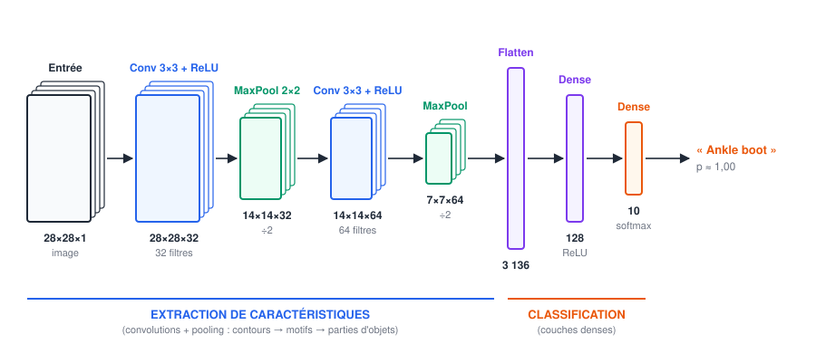
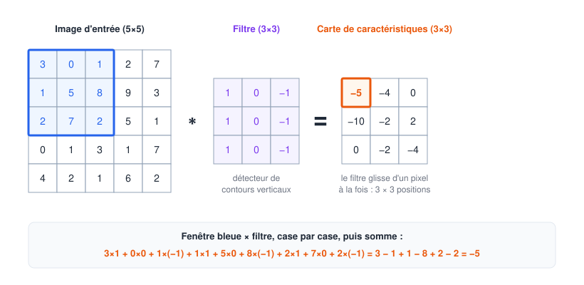
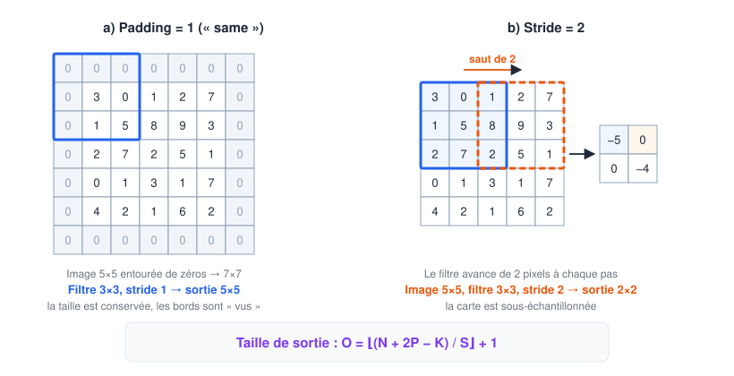
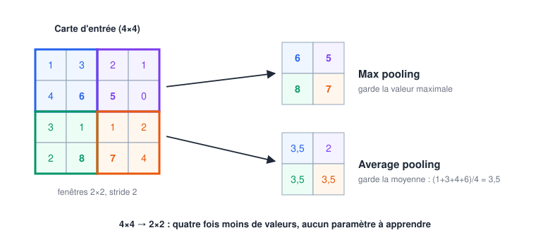
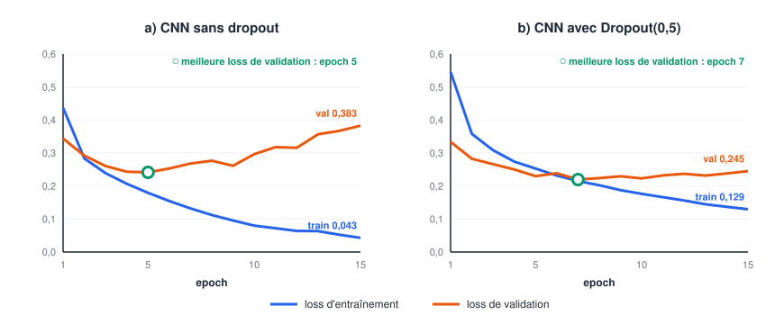
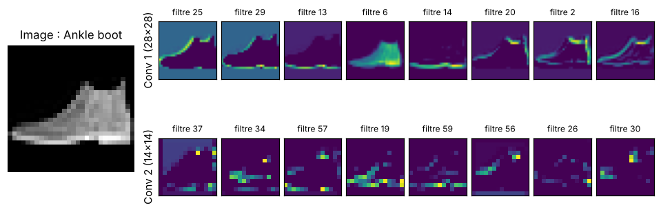

# 🖼️ Concevoir et entraîner des CNN (Design and Train CNNs) — Cours Bootcamp Data Science

> **Module Data Science — Deep Learning** | Prérequis : cours "Forward & Backward Propagation" (`03-...md`), cours "Fondamentaux IA/ML/DL" (`01-...md`), NumPy

---

## Table des matières

### Partie I — Pourquoi des réseaux convolutifs ?
1. [Introduction : apprendre à voir](#1-introduction--apprendre-à-voir)
2. [🧩 Comment un ordinateur voit une image](#2--comment-un-ordinateur-voit-une-image)
3. [Les limites d'un réseau dense face aux images](#3-les-limites-dun-réseau-dense-face-aux-images)
4. [L'idée du CNN : trois principes](#4-lidée-du-cnn--trois-principes)

### Partie II — L'architecture d'un CNN (CNN Architecture)
5. [Vue d'ensemble d'un CNN](#5-vue-densemble-dun-cnn)
6. [La couche de convolution](#6-la-couche-de-convolution)
7. [La fonction d'activation ReLU](#7-la-fonction-dactivation-relu)
8. [La couche de pooling](#8-la-couche-de-pooling)
9. [Flatten, couches denses et sortie softmax](#9-flatten-couches-denses-et-sortie-softmax)
10. [🧩 Concevoir son architecture : les règles pratiques](#10--concevoir-son-architecture--les-règles-pratiques)
11. [🧩 Les architectures de référence](#11--les-architectures-de-référence)

### Partie III — Entraîner un CNN (Training CNNs)
12. [Le pipeline d'entraînement](#12-le-pipeline-dentraînement)
13. [Étape 1 — Préparer les données](#13-étape-1--préparer-les-données)
14. [Étape 2 — Construire et compiler le modèle](#14-étape-2--construire-et-compiler-le-modèle)
15. [Étape 3 — Entraîner et évaluer](#15-étape-3--entraîner-et-évaluer)
16. [🧩 Ce qui se passe pendant `fit()` : la backpropagation dans un CNN](#16--ce-qui-se-passe-pendant-fit--la-backpropagation-dans-un-cnn)
17. [Lire les courbes d'apprentissage](#17-lire-les-courbes-dapprentissage)
18. [Combattre le surapprentissage](#18-combattre-le-surapprentissage)
19. [Le transfer learning](#19-le-transfer-learning)
20. [🧩 Choisir les hyperparamètres](#20--choisir-les-hyperparamètres)
21. [🧩 Analyser les erreurs et regarder ce que le CNN voit](#21--analyser-les-erreurs-et-regarder-ce-que-le-cnn-voit)
22. [🧩 Diagnostiquer un entraînement qui échoue](#22--diagnostiquer-un-entraînement-qui-échoue)

### Partie IV — Panorama
23. [Au-delà de la classification : détection et segmentation](#23-au-delà-de-la-classification--détection-et-segmentation)
24. [Avantages et limites des CNN](#24-avantages-et-limites-des-cnn)

### Partie V — Synthèse
25. [Conclusion](#25-conclusion)
26. [✅ Point de contrôle — Design and Train CNNs](#26--point-de-contrôle--design-and-train-cnns)

> 🧩 = notion ajoutée au plan initial parce qu'elle est indispensable pour comprendre ou pratiquer.

> ⚙️ **Environnement** : les exemples utilisent **TensorFlow / Keras** (`pip install tensorflow`). Tous les résultats affichés ont été obtenus en exécutant réellement le code (TensorFlow 2.21, CPU) ; les vôtres peuvent varier de quelques dixièmes de point selon la machine et la version.

---

# PARTIE I — POURQUOI DES RÉSEAUX CONVOLUTIFS ?

## 1. Introduction : apprendre à voir

### 📖 Définition

Un **réseau de neurones convolutif** (*Convolutional Neural Network*, **CNN** ou **ConvNet**) est un réseau de neurones spécialisé dans les données organisées en **grille** — avant tout les **images**. Au lieu de relier chaque pixel à chaque neurone, il fait **glisser de petits filtres** sur l'image pour y détecter des motifs locaux (contours, textures, formes), puis combine ces motifs, couche après couche, en concepts de plus en plus abstraits (un œil, une roue, une feuille malade).

> 💡 **Analogie de la lampe torche** : imaginez que vous examinez une grande affiche dans le noir avec une petite lampe torche. Vous ne voyez qu'un petit carré à la fois, mais en balayant toute l'affiche, vous repérez partout où se trouve un certain motif. Un filtre de CNN fait exactement cela : il **balaie** l'image et note, à chaque position, **à quel point** le motif qu'il recherche est présent.

Les CNN ont fait entrer le Deep Learning dans l'ère moderne : en 2012, le réseau **AlexNet** a remporté le concours ImageNet (1,2 million d'images, 1 000 classes) avec une erreur top-5 de 15,3 %, contre 26,2 % pour le meilleur concurrent. Depuis, ils sont partout : smartphones, voitures, imagerie médicale, agriculture.

### 1.1 Ce que vous saurez faire à la fin de ce cours

| Partie | Compétence |
|--------|------------|
| **Architecture** | expliquer convolution, filtre, stride, padding, pooling ; calculer la taille des sorties et le nombre de paramètres d'un CNN |
| **Conception** | assembler une architecture cohérente à partir de règles éprouvées |
| **Entraînement** | préparer des images, construire, compiler, entraîner et évaluer un CNN avec Keras |
| **Amélioration** | lire des courbes d'apprentissage, combattre le surapprentissage, réutiliser un modèle pré-entraîné (transfer learning) |

---

## 2. 🧩 Comment un ordinateur voit une image

Pour un ordinateur, une image n'est qu'un **tableau de nombres**.

| Type d'image | Forme du tableau | Valeurs |
|--------------|------------------|---------|
| **Niveaux de gris** | hauteur × largeur × **1** (ex. : 28 × 28 × 1) | 0 (noir) à 255 (blanc) |
| **Couleur (RGB)** | hauteur × largeur × **3** (ex. : 224 × 224 × 3) | 3 canaux : rouge, vert, bleu, chacun de 0 à 255 |

```
IMAGE EN NIVEAUX DE GRIS (1 canal)        IMAGE COULEUR (3 canaux empilés)
┌───────────────────────┐                  ┌───────────────────────┐ canal R
│   0   0  12  87 ...   │                  │  ┌───────────────────────┐ canal G
│   0  45 210 255 ...   │ ← 1 nombre       │  │  ┌───────────────────────┐ canal B
│   3 180 255 240 ...   │   par pixel      └──│  │  3 nombres par pixel  │
│  ...                  │                     └──│  (rouge, vert, bleu)  │
└───────────────────────┘                        └───────────────────────┘
 28 × 28 × 1 = 784 valeurs                  224 × 224 × 3 = 150 528 valeurs
```

On appelle **canaux** (*channels*) la troisième dimension. Ce vocabulaire est essentiel : à l'intérieur d'un CNN, les couches produisent elles aussi des tableaux « hauteur × largeur × canaux », où chaque canal est une **carte de caractéristiques** (*feature map*).

> 🔑 **Convention Keras** : une image est un tenseur `(hauteur, largeur, canaux)` et un lot d'images un tenseur `(batch, hauteur, largeur, canaux)`. Une image en niveaux de gris doit donc avoir un canal explicite : `(28, 28)` → `(28, 28, 1)`.

---

## 3. Les limites d'un réseau dense face aux images

Le cours précédent a montré qu'un réseau dense (MLP) peut tout approcher. Pourquoi ne pas l'utiliser sur des images ? Trois raisons.

### 3.1 L'explosion du nombre de paramètres

Une image couleur de 224 × 224 contient 150 528 valeurs. Si la première couche cachée compte 1 000 neurones, **chaque** neurone est relié à **chaque** pixel :

$$150\,528 \times 1\,000 = 150\,528\,000 \text{ poids} \quad (\text{+ } 1\,000 \text{ biais})$$

Plus de **150 millions de paramètres pour une seule couche** : entraînement lent, mémoire saturée, et surtout un risque énorme de surapprentissage.

### 3.2 La structure spatiale est détruite

Pour entrer dans un réseau dense, l'image est **aplatie** en un long vecteur. Deux pixels voisins verticalement se retrouvent à 224 positions d'écart : le réseau ne sait plus qu'ils étaient côte à côte. Or, dans une image, **l'information est locale** : un contour, c'est un groupe de pixels voisins qui changent brusquement.

### 3.3 Aucune invariance par translation

Un réseau dense qui a appris à reconnaître un chat **au centre** de l'image doit **réapprendre** le chat en haut à gauche, avec d'autres poids. Il ne « sait » pas qu'un motif reste le même où qu'il se trouve.

| Problème du réseau dense | Réponse du CNN |
|--------------------------|----------------|
| Trop de paramètres | un petit filtre (ex. : 3 × 3) **réutilisé** sur toute l'image |
| Structure spatiale perdue | chaque neurone regarde une **zone locale** de pixels voisins |
| Pas d'invariance par translation | le **même** filtre détecte le motif **partout** |

---

## 4. L'idée du CNN : trois principes

### 4.1 La connectivité locale

Chaque neurone d'une couche convolutive n'est relié qu'à une **petite zone** de l'entrée (par exemple 3 × 3 pixels), appelée son **champ récepteur**. Il se spécialise donc dans un motif local.

### 4.2 Le partage des poids

Le **même filtre** (les mêmes poids) est appliqué à **toutes** les positions de l'image. Un filtre 3 × 3 sur une image en niveaux de gris n'a que 9 poids + 1 biais, que l'image fasse 28 × 28 ou 4 000 × 3 000 pixels.

> 🔑 Comparez : un filtre convolutif de **64 filtres 3 × 3** sur une image couleur a $(3 \times 3 \times 3 + 1) \times 64 = 1\,792$ paramètres, contre **150 millions** pour la couche dense de la section 3.1.

### 4.3 La hiérarchie des caractéristiques

Les couches s'empilent, et chacune construit sur la précédente :

```
Couches basses         Couches intermédiaires        Couches hautes
┌──────────────┐       ┌────────────────────┐       ┌──────────────────┐
│ contours,    │  ──►  │ textures, coins,   │  ──►  │ parties d'objets │ ──► « chat »
│ couleurs     │       │ motifs simples     │       │ (yeux, oreilles) │
└──────────────┘       └────────────────────┘       └──────────────────┘
     ╲ petit champ récepteur                        grand champ récepteur ╱
```

> 💡 **Analogie de la lecture** : on reconnaît d'abord des traits, puis des lettres, puis des mots, puis des phrases. Personne n'a programmé ces étapes : le CNN les **découvre** pendant l'entraînement, parce qu'elles l'aident à réduire sa loss.

### 4.4 🧩 Conséquence : l'équivariance et l'invariance par translation

- La **convolution** est **équivariante** : si l'objet se déplace dans l'image, sa détection se déplace d'autant dans la carte de caractéristiques.
- Le **pooling** (section 8) ajoute une **invariance** locale : un petit décalage de l'objet ne change presque pas la sortie.

Ensemble, ils permettent de reconnaître un objet quelle que soit sa position — exactement ce qui manquait au réseau dense.

---

# PARTIE II — L'ARCHITECTURE D'UN CNN (CNN ARCHITECTURE)

## 5. Vue d'ensemble d'un CNN



*Figure 1 — Le CNN que nous construirons et entraînerons dans la Partie III. Les dimensions sont écrites sous chaque bloc.*

Un CNN classique se lit de gauche à droite en **deux grandes parties** :

| Partie | Couches | Rôle |
|--------|---------|------|
| **Extraction de caractéristiques** (*feature extractor*) | répétition de **[Convolution → ReLU → (Convolution → ReLU) → Pooling]** | transformer les pixels en caractéristiques de plus en plus abstraites ; la taille spatiale **diminue**, le nombre de canaux **augmente** |
| **Classification** (*classifier head*) | **Flatten** (ou Global Average Pooling) → **Dense** → **Dense softmax** | combiner les caractéristiques pour décider de la classe |

```
ENTRÉE ─► [CONV → RELU] ─► POOL ─► [CONV → RELU] ─► POOL ─► FLATTEN ─► DENSE ─► SOFTMAX
28×28×1     28×28×32      14×14×32   14×14×64       7×7×64    3 136       128        10

  taille spatiale :  28 ──────► 14 ──────► 7           (on « résume » l'image)
  nombre de canaux :  1 ──────► 32 ──────► 64          (on enrichit la description)
```

Nous détaillons maintenant chaque brique.

---

## 6. La couche de convolution

### 📖 Définition

La **convolution** fait glisser un petit tableau de poids, le **filtre** (ou **noyau**, *kernel*), sur toute l'image. À chaque position, on multiplie case par case le filtre et la zone d'image qu'il recouvre, puis on **additionne** tout (et on ajoute un biais). Le résultat, rangé dans un nouveau tableau, est une **carte de caractéristiques** (*feature map*).

### 6.1 L'opération pas à pas



*Figure 2 — Convolution d'une image 5 × 5 par un filtre 3 × 3 (sans biais). Chaque position du filtre produit une case de la carte de caractéristiques.*

Le filtre ci-dessus vaut :

$$K = \begin{pmatrix} 1 & 0 & -1 \\ 1 & 0 & -1 \\ 1 & 0 & -1 \end{pmatrix}$$

**Position (0, 0)** — la fenêtre bleue couvre les lignes 0 à 2 et les colonnes 0 à 2 :

$$3 \times 1 + 0 \times 0 + 1 \times (-1) + 1 \times 1 + 5 \times 0 + 8 \times (-1) + 2 \times 1 + 7 \times 0 + 2 \times (-1) = -5$$

**Position (0, 1)** — on décale le filtre d'une colonne vers la droite (colonnes 1 à 3) :

$$0 - 2 + 5 - 9 + 7 - 5 = -4$$

En continuant ainsi sur les 3 × 3 positions possibles, on obtient la carte complète :

$$\begin{pmatrix} -5 & -4 & 0 \\ -10 & -2 & 2 \\ 0 & -2 & -4 \end{pmatrix}$$

La formule générale, pour un filtre $K$ de taille $k \times k$ et un biais $b$ :

$$\boxed{\; S(i, j) = \sum_{u=0}^{k-1} \sum_{v=0}^{k-1} X(i+u,\; j+v)\, K(u, v) + b \;}$$

```python
import numpy as np

def conv2d(X, K, b=0, stride=1):
    """Convolution 2D 'valid' (sans padding) d'une image X par un filtre K."""
    k = K.shape[0]
    h_out = (X.shape[0] - k) // stride + 1
    w_out = (X.shape[1] - k) // stride + 1
    S = np.zeros((h_out, w_out))
    for i in range(h_out):
        for j in range(w_out):
            fenetre = X[i*stride:i*stride+k, j*stride:j*stride+k]
            S[i, j] = np.sum(fenetre * K) + b      # produit case par case, puis somme
    return S

X = np.array([[3, 0, 1, 2, 7],
              [1, 5, 8, 9, 3],
              [2, 7, 2, 5, 1],
              [0, 1, 3, 1, 7],
              [4, 2, 1, 6, 2]])
K = np.array([[1, 0, -1],
              [1, 0, -1],
              [1, 0, -1]])
print(conv2d(X, K))
# [[ -5.  -4.   0.]
#  [-10.  -2.   2.]
#  [  0.  -2.  -4.]]
```

> 🧩 **Petite précision mathématique** : en mathématiques, une « vraie » convolution retourne le filtre avant de le faire glisser. Les bibliothèques de Deep Learning ne le font pas : elles calculent une **corrélation croisée**. Comme les poids du filtre sont **appris**, cela ne change rien en pratique, et tout le monde parle de « convolution ».

### 6.2 Ce que détecte un filtre

Appliquons le même filtre à une image qui contient un **contour vertical** : une moitié gauche claire (10) et une moitié droite sombre (0).

```
Image 6×6                         Filtre                 Carte 4×4
10 10 10  0  0  0                 1  0 -1                0  30  30  0
10 10 10  0  0  0                 1  0 -1                0  30  30  0
10 10 10  0  0  0        ∗        1  0 -1       =        0  30  30  0
10 10 10  0  0  0                                        0  30  30  0
10 10 10  0  0  0
10 10 10  0  0  0
     ↑ contour                                              ↑ contour détecté
```

- Là où l'image est **uniforme**, la colonne de gauche et celle de droite du filtre s'annulent : sortie **0**.
- Là où la fenêtre **chevauche le contour**, la colonne « +1 » voit du clair et la colonne « −1 » du sombre : sortie **forte (30)**.
- Avec un contour inversé (sombre à gauche, clair à droite), on obtient **−30** : le signe indique le **sens** du contour.

> 🔑 **Une carte de caractéristiques est une carte de « présence » du motif** : ses valeurs élevées indiquent **où** le filtre a trouvé ce qu'il cherche.

Quelques filtres classiques du traitement d'image :

| Filtre | Noyau 3 × 3 | Effet |
|--------|-------------|-------|
| Contours verticaux | `[[1,0,-1],[1,0,-1],[1,0,-1]]` | détecte les transitions gauche/droite |
| Contours horizontaux | `[[1,1,1],[0,0,0],[-1,-1,-1]]` | détecte les transitions haut/bas |
| Sobel vertical | `[[1,0,-1],[2,0,-2],[1,0,-1]]` | contours verticaux, plus robuste au bruit |
| Flou (moyenne) | tous les coefficients à 1/9 | lisse l'image |
| Netteté | `[[0,-1,0],[-1,5,-1],[0,-1,0]]` | accentue les détails |

> 💡 **La grande différence avec le traitement d'image classique** : dans un CNN, **personne n'écrit ces filtres**. Leurs 9 coefficients sont des **poids**, initialisés au hasard puis ajustés par backpropagation. Le réseau découvre seul les filtres utiles à sa tâche — et on retrouve souvent, dans la première couche, des détecteurs de contours très proches de ceux du tableau.

### 6.3 Plusieurs canaux en entrée, plusieurs filtres en sortie

Deux règles suffisent à comprendre les dimensions d'une couche de convolution :

1. **Un filtre a toujours la même profondeur que son entrée.** Sur une image RGB (3 canaux), un filtre « 3 × 3 » est en réalité un bloc **3 × 3 × 3** : il fait la somme des produits sur les trois canaux et produit **une seule** carte.
2. **Le nombre de filtres fixe le nombre de canaux de sortie.** Une couche de 32 filtres produit 32 cartes de caractéristiques empilées.

```
ENTRÉE 32×32×3            32 FILTRES de 3×3×3              SORTIE 30×30×32
┌──────────┐              ┌───┐ ┌───┐       ┌───┐          ┌──────────┐
│          │╲     ∗       │ 1 │ │ 2 │  ...  │32 │    =     │ 32 cartes │╲
│  R G B   │ │            └───┘ └───┘       └───┘          │ empilées  │ │
└──────────┘ │            (chacun → 1 carte 30×30)         └──────────┘ │
 ╲__________╲│                                              ╲__________╲│
```

> 🔑 **Profondeur du filtre = canaux d'entrée. Nombre de filtres = canaux de sortie.**

### 6.4 Le pas (stride) et le remplissage (padding)



*Figure 3 — a) Le padding ajoute une bordure de zéros pour conserver la taille. b) Le stride fait avancer le filtre de plusieurs pixels à la fois.*

**Le stride (pas)** est le nombre de pixels dont le filtre se déplace à chaque étape.

- **Stride = 1** (le défaut) : le filtre visite toutes les positions.
- **Stride = 2** : il saute une position sur deux ; la sortie est environ **deux fois plus petite** dans chaque direction. Sur notre image 5 × 5, on obtient la carte 2 × 2 $\begin{pmatrix} -5 & 0 \\ 0 & -4 \end{pmatrix}$, c'est-à-dire une case sur deux de la carte 3 × 3 complète.

**Le padding (remplissage)** ajoute une bordure de zéros autour de l'entrée. Sans lui :

- la sortie **rétrécit** à chaque couche (5 × 5 → 3 × 3 → 1 × 1 : après deux couches, il ne reste rien) ;
- les pixels du **bord** sont moins « vus » que ceux du centre (un coin n'est couvert qu'une fois).

| Option Keras | Padding | Taille de sortie (stride 1) | Usage |
|--------------|---------|-----------------------------|-------|
| `padding="valid"` (défaut) | aucun ($P = 0$) | $N - K + 1$ : **rétrécit** | quand on veut réduire la taille |
| `padding="same"` | $P = (K-1)/2$ (1 pour un filtre 3 × 3) | $N$ : **conservée** | ⭐ le plus courant ; le pooling se charge de réduire |

### 6.5 🧩 Calculer la taille de sortie

Pour une entrée de taille $N \times N$, un filtre $K \times K$, un padding $P$ et un stride $S$ :

$$\boxed{\; O = \left\lfloor \frac{N + 2P - K}{S} \right\rfloor + 1 \;}$$

($\lfloor \cdot \rfloor$ = partie entière inférieure.)

| Entrée $N$ | Filtre $K$ | Padding $P$ | Stride $S$ | Calcul | Sortie $O$ |
|-----------|-----------|-------------|-----------|--------|-----------|
| 5 | 3 | 0 | 1 | (5 + 0 − 3)/1 + 1 | **3** (Figure 2) |
| 5 | 3 | 1 | 1 | (5 + 2 − 3)/1 + 1 | **5** (Figure 3a) |
| 5 | 3 | 0 | 2 | (5 + 0 − 3)/2 + 1 | **2** (Figure 3b) |
| 28 | 3 | 1 | 1 | (28 + 2 − 3)/1 + 1 | **28** (`same`) |
| 32 | 5 | 0 | 1 | (32 − 5)/1 + 1 | **28** (LeNet-5) |
| 224 | 7 | 3 | 2 | ⌊223/2⌋ + 1 | **112** (1ʳᵉ couche de ResNet) |

> ⚠️ **La profondeur de sortie ne dépend pas de cette formule** : elle est égale au **nombre de filtres**.

### 6.6 🧩 Compter les paramètres d'une couche de convolution

Chaque filtre a $K \times K \times C_{\text{entrée}}$ poids et **1** biais. Avec $C_{\text{sortie}}$ filtres :

$$\boxed{\; \text{paramètres} = (K \times K \times C_{\text{entrée}} + 1) \times C_{\text{sortie}} \;}$$

| Couche | Calcul | Paramètres |
|--------|--------|------------|
| Conv 3 × 3, 32 filtres, sur une image 28 × 28 × **1** | (3 × 3 × 1 + 1) × 32 | **320** |
| Conv 3 × 3, 64 filtres, sur 14 × 14 × **32** | (3 × 3 × 32 + 1) × 64 | **18 496** |
| Conv 3 × 3, 64 filtres, sur une image RGB 224 × 224 × **3** | (3 × 3 × 3 + 1) × 64 | **1 792** |

> 🔑 **Le nombre de paramètres d'une convolution ne dépend pas de la taille de l'image** (28 × 28 ou 224 × 224 : même nombre). C'est la grande force du partage des poids. En revanche, le **temps de calcul**, lui, augmente avec la taille de l'image.

### 6.7 🧩 Le champ récepteur

Le **champ récepteur** d'un neurone est la zone de l'image d'origine qui influence sa valeur.

- Après **une** convolution 3 × 3 : chaque valeur « voit » 3 × 3 pixels.
- Après **deux** convolutions 3 × 3 empilées : 5 × 5 pixels.
- Après **trois** : 7 × 7 pixels.
- Chaque **pooling** 2 × 2 double la vitesse à laquelle le champ grandit ensuite.

Dans le CNN de la Figure 1, chaque valeur de la dernière carte 7 × 7 × 64 « voit » une zone de **10 × 10 pixels** de l'image 28 × 28 : assez pour reconnaître une partie de vêtement (un col, une semelle, une manche).

> 💡 **Pourquoi des filtres 3 × 3 partout ?** Deux convolutions 3 × 3 ont le même champ récepteur qu'une convolution 5 × 5, mais avec moins de paramètres ($2 \times 9 = 18$ contre $25$ par paire de canaux) et **une non-linéarité de plus**. C'est l'idée clé de l'architecture VGG (section 11), devenue la norme.

---

## 7. La fonction d'activation ReLU

Comme dans tout réseau de neurones, chaque convolution est suivie d'une **activation non linéaire**, appliquée **case par case** à la carte de caractéristiques. Le choix par défaut est **ReLU** :

$$\text{ReLU}(z) = \max(0, z)$$

Sur la carte de la Figure 2 :

$$\begin{pmatrix} -5 & -4 & 0 \\ -10 & -2 & 2 \\ 0 & -2 & -4 \end{pmatrix} \xrightarrow{\text{ReLU}} \begin{pmatrix} 0 & 0 & 0 \\ 0 & 0 & 2 \\ 0 & 0 & 0 \end{pmatrix}$$

| Pourquoi ReLU ? | Explication |
|-----------------|-------------|
| **Non-linéarité** | sans elle, empiler des convolutions reviendrait à une seule convolution (cours 03) |
| **Sélectivité** | ne garde que les endroits où le motif est **présent** (valeurs positives) |
| **Gradient sain** | dérivée égale à 1 pour $z > 0$ : limite le gradient qui s'évanouit dans les réseaux profonds |
| **Rapidité** | un simple `max`, très rapide à calculer |

> 💡 En Keras, on écrit l'activation directement dans la couche : `layers.Conv2D(32, (3, 3), activation="relu")`.

---

## 8. La couche de pooling

### 📖 Définition

Le **pooling** (sous-échantillonnage) réduit la taille spatiale des cartes de caractéristiques en **résumant** chaque petite zone par une seule valeur. Il est appliqué **canal par canal** : le nombre de canaux ne change pas.



*Figure 4 — Pooling 2 × 2 avec un stride de 2 : chaque zone colorée est résumée par une valeur.*

| Type | Opération | Usage |
|------|-----------|-------|
| **Max pooling** ⭐ | garde la **valeur maximale** de la zone | le plus courant entre les blocs convolutifs : « le motif est-il présent quelque part dans la zone ? » |
| **Average pooling** | garde la **moyenne** de la zone | plus doux ; moins utilisé entre les blocs |
| **Global Average Pooling** (GAP) | moyenne de **toute** la carte → une valeur par canal | en fin de réseau, à la place de Flatten (section 9.2) |

### 8.1 Les effets du pooling

1. **Moins de calcul** : un pooling 2 × 2 divise par **4** le nombre de valeurs (14 × 14 au lieu de 28 × 28).
2. **Un champ récepteur qui grandit plus vite** : les couches suivantes voient une plus grande partie de l'image.
3. **Une invariance aux petits décalages** : si le motif bouge d'un pixel à l'intérieur de la zone, le maximum ne change pas.
4. **Aucun paramètre** : le pooling ne s'entraîne pas (0 paramètre dans `model.summary()`).

> 🔑 Configuration standard : `layers.MaxPooling2D((2, 2))` — fenêtre 2 × 2, stride 2 — qui **divise par 2** la hauteur et la largeur.

> 💡 Certaines architectures modernes remplacent le pooling par une **convolution de stride 2**, qui réduit aussi la taille mais en apprenant **comment** résumer.

---

## 9. Flatten, couches denses et sortie softmax

### 9.1 Flatten puis Dense

Après les blocs convolutifs, on obtient un volume de caractéristiques (7 × 7 × 64 dans la Figure 1). Pour décider de la classe, on le transforme en vecteur, puis on utilise des couches **denses** — exactement celles du cours 03.

| Couche | Rôle | Dans notre CNN |
|--------|------|----------------|
| **Flatten** | aplatit le volume en un vecteur (0 paramètre) | 7 × 7 × 64 → **3 136** valeurs |
| **Dense + ReLU** | combine les caractéristiques | 3 136 → 128 : 3 136 × 128 + 128 = **401 536** paramètres |
| **Dense + softmax** | une probabilité par classe (somme = 1) | 128 → 10 : 128 × 10 + 10 = **1 290** paramètres |

> ⚠️ **Observation importante** : dans ce CNN, la couche dense après Flatten concentre **95 %** des paramètres (401 536 sur 421 642), alors que les deux convolutions n'en ont que 18 816. C'est souvent elle qui surapprend.

### 9.2 🧩 L'alternative moderne : Global Average Pooling

Le **Global Average Pooling** remplace chaque carte 7 × 7 par sa **moyenne** : le volume 7 × 7 × 64 devient un vecteur de **64** valeurs. La couche dense suivante passe alors de 401 536 paramètres à $64 \times 128 + 128 = 8\,320$.

```python
# Tête « classique » : 7×7×64 -> 3 136 -> 128 -> 10    (402 826 paramètres)
tete_flatten = [layers.Flatten(),
                layers.Dense(128, activation="relu"),
                layers.Dense(10, activation="softmax")]

# Tête moderne (ResNet, MobileNet…) : 7×7×64 -> 64 -> 128 -> 10   (9 610 paramètres)
tete_gap = [layers.GlobalAveragePooling2D(),
            layers.Dense(128, activation="relu"),
            layers.Dense(10, activation="softmax")]
```

### 9.3 Dimensionner la sortie

C'est la même règle que pour un réseau dense (cours 03, section 5.1) :

| Tâche | Dernière couche | Loss Keras |
|-------|-----------------|------------|
| Binaire (malade / sain) | `Dense(1, activation="sigmoid")` | `"binary_crossentropy"` |
| Multiclasse, étiquettes entières (0, 1, …, 9) | `Dense(K, activation="softmax")` | `"sparse_categorical_crossentropy"` |
| Multiclasse, étiquettes one-hot | `Dense(K, activation="softmax")` | `"categorical_crossentropy"` |
| Régression (âge estimé sur une photo) | `Dense(1)` (linéaire) | `"mse"` |

---

## 10. 🧩 Concevoir son architecture : les règles pratiques

Concevoir un CNN n'est pas un art mystérieux : quelques règles éprouvées couvrent la plupart des cas.

### 10.1 Les règles de conception

| # | Règle | Pourquoi |
|---|-------|----------|
| 1 | Utiliser des filtres **3 × 3** avec `padding="same"` | petits, efficaces, empilables (section 6.7) |
| 2 | Organiser le réseau en **blocs** : 1 à 3 convolutions + ReLU, puis un **MaxPooling 2 × 2** | motif éprouvé (VGG) |
| 3 | **Doubler le nombre de filtres** quand on divise la taille par 2 (32 → 64 → 128…) | on conserve à peu près la quantité d'information tout en l'abstrayant |
| 4 | Arrêter de réduire quand la carte fait environ **4 × 4 à 8 × 8** | en dessous, il ne reste plus d'information spatiale |
| 5 | Terminer par **GlobalAveragePooling** (ou Flatten) puis 1 couche dense et la sortie | réduit les paramètres de la tête |
| 6 | Ajouter **BatchNormalization** et **Dropout** si le réseau surapprend (section 18) | stabilité et régularisation |
| 7 | **Commencer petit**, puis agrandir si le modèle sous-apprend | un modèle simple qui fonctionne vaut mieux qu'un gros qui ne converge pas |
| 8 | Pour une vraie application, **partir d'un modèle pré-entraîné** (section 19) | meilleur résultat avec peu de données |

### 10.2 Suivre les dimensions couche par couche

Avant d'écrire une ligne de code, on vérifie le **chemin des dimensions** et le **nombre de paramètres**. Pour le CNN de la Figure 1 :

| # | Couche | Calcul de la taille | Sortie | Paramètres |
|---|--------|---------------------|--------|------------|
| 0 | Entrée | — | 28 × 28 × 1 | 0 |
| 1 | Conv 3 × 3, 32 filtres, `same`, ReLU | (28 + 2 − 3)/1 + 1 = 28 | 28 × 28 × 32 | (9 × 1 + 1) × 32 = **320** |
| 2 | MaxPool 2 × 2 | 28 / 2 | 14 × 14 × 32 | 0 |
| 3 | Conv 3 × 3, 64 filtres, `same`, ReLU | 14 | 14 × 14 × 64 | (9 × 32 + 1) × 64 = **18 496** |
| 4 | MaxPool 2 × 2 | 14 / 2 | 7 × 7 × 64 | 0 |
| 5 | Flatten | 7 × 7 × 64 | 3 136 | 0 |
| 6 | Dense 128, ReLU | — | 128 | 3 136 × 128 + 128 = **401 536** |
| 7 | Dense 10, softmax | — | 10 | 128 × 10 + 10 = **1 290** |
| | **Total** | | | **421 642** |

> 🔑 Keras confirmera ce total avec `model.summary()` (section 14). Savoir le recalculer à la main est le meilleur moyen de détecter une architecture mal construite.

---

## 11. 🧩 Les architectures de référence

L'histoire des CNN est une suite d'idées qui sont devenues des briques standard.

| Architecture | Année | Paramètres | Idée clé |
|--------------|-------|------------|----------|
| **LeNet-5** | 1998 | ~60 000 | premier CNN opérationnel (lecture des chèques) ; le motif conv → pool → dense |
| **AlexNet** | 2012 | ~60 millions | ReLU, Dropout, entraînement sur GPU ; remporte ImageNet et lance le Deep Learning |
| **VGG-16** | 2014 | ~138 millions | uniquement des filtres 3 × 3, en blocs ; simple et profond (16 couches) |
| **GoogLeNet / Inception** | 2014 | ~7 millions | filtres de plusieurs tailles en parallèle ; convolutions 1 × 1 pour réduire les canaux |
| **ResNet-50** | 2015 | ~25 millions | **connexions résiduelles** : permettent d'entraîner des réseaux de 50 à 150 couches et plus |
| **MobileNetV2** | 2018 | ~3,5 millions | convolutions *depthwise separable* : léger, conçu pour les smartphones |
| **EfficientNet-B0** | 2019 | ~5,3 millions | agrandit profondeur, largeur et résolution de façon équilibrée |

### 11.1 Zoom sur l'idée de ResNet : la connexion résiduelle

Plus un réseau est profond, plus il est difficile à entraîner : le gradient s'évanouit en remontant les couches (cours 03, section 16.2). ResNet ajoute un **raccourci** qui additionne l'entrée d'un bloc à sa sortie :

$$\text{sortie} = F(x) + x$$

```
      x ──────────────────────────┐   (raccourci : identité)
      │                           │
      ▼                           ▼
   [Conv → BN → ReLU → Conv → BN] ──► (+) ──► ReLU ──► sortie
             F(x)
```

Le bloc n'a plus qu'à apprendre une **correction** $F(x)$ de son entrée, et le gradient peut traverser le raccourci sans s'atténuer.

> 💡 **Message pratique** : vous n'aurez presque jamais à reprogrammer ces architectures. Elles sont disponibles, **déjà entraînées sur ImageNet**, dans `keras.applications`. C'est la base du transfer learning (section 19).

---

# PARTIE III — ENTRAÎNER UN CNN (TRAINING CNNS)

## 12. Le pipeline d'entraînement

Un CNN s'entraîne **exactement comme le réseau du cours 03** : forward → loss → backpropagation → mise à jour, répété sur des mini-batchs pendant plusieurs epochs. Keras organise ce travail en étapes claires :

```
┌──────────────────────────────────────────────────────────────────────────┐
│ 1. PRÉPARER LES DONNÉES   normaliser, ajouter le canal, séparer           │
│                           train / validation / test                        │
│ 2. CONSTRUIRE             empiler les couches : keras.Sequential([...])    │
│ 3. COMPILER               choisir loss, optimiseur, métriques : compile()  │
│ 4. ENTRAÎNER              fit() : forward + backprop + mise à jour         │
│ 5. ÉVALUER                courbes d'apprentissage, evaluate() sur le test  │
│ 6. AMÉLIORER              régularisation, augmentation, transfer learning  │
│ 7. UTILISER               save(), load_model(), predict()                  │
└──────────────────────────────────────────────────────────────────────────┘
```

### 12.1 Le jeu de données : Fashion-MNIST

Nous utilisons **Fashion-MNIST** : 70 000 images 28 × 28 en niveaux de gris de **10 types de vêtements**. Il est livré avec Keras, assez petit pour s'entraîner sur un ordinateur portable, mais nettement plus difficile que les chiffres manuscrits de MNIST.

| Étiquette | Classe | Étiquette | Classe |
|-----------|--------|-----------|--------|
| 0 | T-shirt/top | 5 | Sandal (sandale) |
| 1 | Trouser (pantalon) | 6 | Shirt (chemise) |
| 2 | Pullover | 7 | Sneaker (basket) |
| 3 | Dress (robe) | 8 | Bag (sac) |
| 4 | Coat (manteau) | 9 | Ankle boot (bottine) |

---

## 13. Étape 1 — Préparer les données

```python
import numpy as np
import keras
from keras import layers

keras.utils.set_random_seed(42)          # reproductibilité

(X_train, y_train), (X_test, y_test) = keras.datasets.fashion_mnist.load_data()
print(X_train.shape, X_test.shape, X_train.min(), X_train.max())
# (60000, 28, 28) (10000, 28, 28) 0 255

# 1) Normaliser les pixels dans [0, 1]
X_train = X_train.astype("float32") / 255.0
X_test  = X_test.astype("float32") / 255.0

# 2) Ajouter l'axe des canaux : (60000, 28, 28) -> (60000, 28, 28, 1)
X_train = X_train[..., np.newaxis]
X_test  = X_test[..., np.newaxis]

class_names = ["T-shirt/top", "Trouser", "Pullover", "Dress", "Coat",
               "Sandal", "Shirt", "Sneaker", "Bag", "Ankle boot"]
```

| Opération | Pourquoi |
|-----------|----------|
| **Diviser par 255** | des entrées entre 0 et 1 rendent la descente de gradient bien plus stable (cours 03, section 16.4) |
| **Ajouter le canal** | `Conv2D` attend des tenseurs `(batch, hauteur, largeur, canaux)` |
| **Garder les étiquettes entières** | avec la loss `sparse_categorical_crossentropy`, pas besoin d'encodage one-hot |
| **Garder un jeu de test intact** | il ne sert qu'**une fois**, à la toute fin (cours *Train/Test Split*, `04-machine-learning/cours/03-...md`) |
| **Prévoir une validation** | `validation_split=0.1` dans `fit()` réserve 10 % du train pour surveiller le surapprentissage |

> ⚠️ **Les pixels sont déjà sur une échelle commune** (0–255) : pas besoin de `StandardScaler`. Diviser par 255 suffit. Pour un modèle pré-entraîné, en revanche, il faut utiliser **sa** fonction de prétraitement (section 19).

---

## 14. Étape 2 — Construire et compiler le modèle

### 14.1 Construire

```python
model = keras.Sequential([
    keras.Input(shape=(28, 28, 1)),

    # --- Extraction de caractéristiques ---
    layers.Conv2D(32, (3, 3), padding="same", activation="relu"),
    layers.MaxPooling2D((2, 2)),
    layers.Conv2D(64, (3, 3), padding="same", activation="relu"),
    layers.MaxPooling2D((2, 2)),

    # --- Classification ---
    layers.Flatten(),
    layers.Dense(128, activation="relu"),
    layers.Dropout(0.5),                         # régularisation (section 18.2)
    layers.Dense(10, activation="softmax"),
])
model.summary()
```

```
┏━━━━━━━━━━━━━━━━━━━━━━━━━━━━━━━━━┳━━━━━━━━━━━━━━━━━━━━━━━━┳━━━━━━━━━━━━━━━┓
┃ Layer (type)                    ┃ Output Shape           ┃       Param # ┃
┡━━━━━━━━━━━━━━━━━━━━━━━━━━━━━━━━━╇━━━━━━━━━━━━━━━━━━━━━━━━╇━━━━━━━━━━━━━━━┩
│ conv2d (Conv2D)                 │ (None, 28, 28, 32)     │           320 │
│ max_pooling2d (MaxPooling2D)    │ (None, 14, 14, 32)     │             0 │
│ conv2d_1 (Conv2D)               │ (None, 14, 14, 64)     │        18,496 │
│ max_pooling2d_1 (MaxPooling2D)  │ (None, 7, 7, 64)       │             0 │
│ flatten (Flatten)               │ (None, 3136)           │             0 │
│ dense (Dense)                   │ (None, 128)            │       401,536 │
│ dropout (Dropout)               │ (None, 128)            │             0 │
│ dense_1 (Dense)                 │ (None, 10)             │         1,290 │
└─────────────────────────────────┴────────────────────────┴───────────────┘
 Total params: 421,642 (1.61 MB)
```

> 🔑 **`None` désigne la taille du batch**, laissée libre. Les autres dimensions et le total (421 642) sont exactement ceux calculés à la main en section 10.2.

### 14.2 Compiler

```python
model.compile(
    optimizer="adam",                            # Adam, learning rate 0.001 par défaut
    loss="sparse_categorical_crossentropy",      # étiquettes entières, sortie softmax
    metrics=["accuracy"],
)
```

| Argument | Choix | Rôle |
|----------|-------|------|
| `optimizer` | **Adam** ⭐ | règle de mise à jour des poids (cours 03, section 10.3) ; robuste par défaut |
| `loss` | entropie croisée catégorielle | ce que la backprop minimise |
| `metrics` | accuracy | ce que **nous** lisons pour juger le modèle (n'intervient pas dans l'apprentissage) |

---

## 15. Étape 3 — Entraîner et évaluer

### 15.1 Entraîner

```python
history = model.fit(
    X_train, y_train,
    epochs=15,
    batch_size=64,
    validation_split=0.1,      # 54 000 images pour apprendre, 6 000 pour valider
)
```

```
Epoch 1/15
844/844 - 12s - 15ms/step - accuracy: 0.8046 - loss: 0.5456 - val_accuracy: 0.8782 - val_loss: 0.3338
Epoch 2/15
844/844 - 11s - 13ms/step - accuracy: 0.8730 - loss: 0.3578 - val_accuracy: 0.8942 - val_loss: 0.2826
...
Epoch 7/15
844/844 - 11s - 14ms/step - accuracy: 0.9214 - loss: 0.2150 - val_accuracy: 0.9197 - val_loss: 0.2196
...
Epoch 15/15
844/844 - 12s - 14ms/step - accuracy: 0.9504 - loss: 0.1294 - val_accuracy: 0.9278 - val_loss: 0.2448
```

| Terme affiché | Signification |
|---------------|---------------|
| `844/844` | nombre d'**itérations** (mini-batchs) par epoch : ⌈54 000 / 64⌉ = 844 |
| `accuracy`, `loss` | mesurées sur les données d'**entraînement** (avec dropout actif) |
| `val_accuracy`, `val_loss` | mesurées sur les 6 000 images de **validation**, jamais utilisées pour apprendre |

### 15.2 Évaluer sur le jeu de test

```python
test_loss, test_acc = model.evaluate(X_test, y_test, verbose=0)
print(f"Accuracy test : {test_acc:.4f}")
# Accuracy test : 0.9176
```

### 15.3 CNN contre réseau dense

Pour mesurer l'apport des convolutions, entraînons dans les mêmes conditions (15 epochs, Adam, batch 64) un réseau dense : `Flatten → Dense(128, relu) → Dense(10, softmax)`.

| Modèle | Paramètres | Accuracy test | Erreurs sur 10 000 images |
|--------|------------|---------------|---------------------------|
| Réseau dense (MLP) | 101 770 | 87,51 % | 1 249 |
| CNN sans dropout | 421 642 | 90,90 % | 910 |
| **CNN avec dropout** (section 14) | 421 642 | **91,76 %** | **824** |

> 🧐 **Interprétation** : le CNN commet **34 % d'erreurs en moins** que le réseau dense (824 contre 1 249). Il a plus de paramètres, mais ce n'est pas la raison principale : 95 % d'entre eux sont dans la couche dense finale. Ce qui fait la différence, ce sont les **convolutions**, qui exploitent la structure locale de l'image (contours d'un col, d'une semelle, d'une anse de sac) au lieu de traiter 784 pixels indépendants.

### 15.4 Prédire

```python
probas = model.predict(X_test[:1], verbose=0)       # forme (1, 10)
classe = probas.argmax(axis=1)[0]
print(class_names[classe], f"{probas.max():.2f}", "| vraie classe :", class_names[y_test[0]])
# Ankle boot 1.00 | vraie classe : Ankle boot
```

Pour une **nouvelle** image (une photo de vêtement), il faut lui appliquer **exactement** le même prétraitement qu'à l'entraînement :

```python
img = keras.utils.load_img("mon_vetement.png", color_mode="grayscale", target_size=(28, 28))
x = keras.utils.img_to_array(img) / 255.0     # (28, 28, 1), valeurs dans [0, 1]
x = 1.0 - x                                   # Fashion-MNIST : vêtement clair sur fond NOIR
probas = model.predict(x[np.newaxis], verbose=0)  # ajouter l'axe du batch -> (1, 28, 28, 1)
```

> ⚠️ **Le piège classique** : un modèle ne fonctionne bien que sur des images **qui ressemblent** à celles de l'entraînement (même taille, même normalisation, même type de fond). Une photo prise avec un téléphone, sur fond blanc, est très différente de Fashion-MNIST : attendez-vous à des erreurs.

### 15.5 🧩 Sauvegarder et recharger

```python
model.save("cnn_fashion.keras")                       # architecture + poids + optimiseur
modele = keras.models.load_model("cnn_fashion.keras")  # prêt pour predict()
```

---

## 16. 🧩 Ce qui se passe pendant `fit()` : la backpropagation dans un CNN

Rien de nouveau sous le soleil : `fit()` exécute la boucle du cours 03, 844 fois par epoch.

```
pour chaque epoch :
    pour chaque mini-batch de 64 images :
        1. FORWARD   conv → relu → pool → ... → softmax → probabilités
        2. LOSS      entropie croisée entre probabilités et vraies classes
        3. BACKWARD  règle de la chaîne, de la sortie vers la première convolution
        4. UPDATE    Adam ajuste les 421 642 paramètres
    mesurer loss et accuracy sur la validation
```

Les seules nouveautés concernent la façon dont le gradient traverse les deux nouvelles couches.

### 16.1 À travers une convolution : le gradient d'un filtre

Un poids $w_{u,v}$ du filtre est utilisé **à toutes les positions** de l'image (partage des poids). Son gradient est donc la **somme** de ses contributions à chaque position :

$$\frac{\partial L}{\partial w_{u,v}} = \sum_{i,j} \delta(i, j) \cdot X(i+u,\; j+v) \qquad \frac{\partial L}{\partial b} = \sum_{i,j} \delta(i, j)$$

où $\delta(i, j) = \partial L / \partial S(i, j)$ est l'erreur de la case $(i, j)$ de la carte de sortie.

> 🔑 C'est la même idée que l'équation 3 du cours 03 (« erreur d'arrivée × activation de départ »), **additionnée sur toutes les positions** où le filtre a été appliqué. Le filtre reçoit l'avis de toute l'image en une seule mise à jour.

### 16.2 À travers un max pooling : le gradient suit le gagnant

Le max pooling n'a pas de paramètre. Pendant la backprop, il transmet le gradient **uniquement à la case qui avait la valeur maximale** ; les trois autres reçoivent 0 (elles n'ont pas influencé la sortie).

```
Forward (Figure 4)               Backward : gradients reçus d'en haut [[a, b], [c, d]]
1  3 │ 2  1                       0  0 │ 0  0
4 [6]│[5] 0      max     6  5     0  a │ b  0
─────┼─────     ────►            ─────┼─────
3  1 │ 1  2              8  7     0  0 │ 0  0
2 [8]│[7] 4                       0  c │ d  0
```

Pour l'**average pooling**, le gradient est au contraire **réparti à parts égales** (÷ 4) entre les quatre cases.

> 💡 Comme pour les réseaux denses, Keras calcule tout cela **automatiquement** (différentiation automatique). Comprendre ces deux règles aide surtout à saisir pourquoi les CNN apprennent si efficacement : peu de paramètres, chacun mis à jour à partir de toute l'image.

---

## 17. Lire les courbes d'apprentissage

L'objet `history` renvoyé par `fit()` contient la loss et l'accuracy de chaque epoch. Les tracer est **le premier réflexe** après un entraînement.

```python
import matplotlib.pyplot as plt

h = history.history
plt.plot(h["loss"], label="train")
plt.plot(h["val_loss"], label="validation")
plt.xlabel("epoch"); plt.ylabel("loss"); plt.legend(); plt.show()
```



*Figure 5 — Courbes de loss obtenues sur Fashion-MNIST (15 epochs). a) Sans dropout, la loss de validation atteint son minimum à l'epoch 5 puis remonte : surapprentissage. b) Avec `Dropout(0.5)`, les deux courbes restent proches et la validation se stabilise.*

Comparons les deux CNN de la section 15.3 :

| | Sans dropout | Avec dropout |
|---|---|---|
| Loss d'entraînement finale | 0,043 | 0,129 |
| Meilleure loss de validation | 0,241 (epoch 5) | 0,220 (epoch 7) |
| Loss de validation finale (epoch 15) | **0,383** ↗ | **0,245** |
| Accuracy entraînement / validation finales | 98,4 % / 91,3 % | 95,0 % / 92,8 % |
| Accuracy test | 90,90 % | **91,76 %** |

> 🧐 **Interprétation** : sans dropout, le réseau atteint 98,4 % sur ses images d'entraînement mais seulement 91,3 % en validation, et sa loss de validation **remonte** à partir de l'epoch 5 : il commence à **mémoriser** au lieu d'apprendre. Le dropout freine cette mémorisation : l'accuracy d'entraînement est plus basse, mais le modèle **généralise** mieux. C'est la validation, et non l'entraînement, qui dit la vérité sur un modèle.

### 17.1 Les trois diagnostics

```
SOUS-APPRENTISSAGE            BON AJUSTEMENT                SURAPPRENTISSAGE
loss                          loss                          loss
 │╲___ val                     │╲                            │╲          ╱ val
 │ ‾‾‾‾‾‾‾‾‾‾‾  (élevées)       │ ╲___ val                    │ ╲___ ___╱
 │╲___ train                   │╲    ‾‾‾‾‾                   │  ╲  ‾
 │ ‾‾‾‾‾‾‾‾‾‾‾                  │ ╲____ train                 │   ╲____ train
 └──────── epochs              └──────── epochs              └──────── epochs
```

| Situation | Symptôme | Remèdes |
|-----------|----------|---------|
| **Sous-apprentissage** | train et validation **mauvaises** toutes les deux | réseau plus grand (plus de filtres, de blocs), plus d'epochs, learning rate mieux réglé, moins de régularisation |
| **Bon ajustement** | les deux courbes baissent et restent **proches** | garder le modèle de la meilleure epoch de validation |
| **Surapprentissage** | train **continue de baisser**, validation **remonte** | augmentation de données, dropout, régularisation, early stopping, plus de données, transfer learning |

> 🔗 C'est le compromis biais / variance du cours *Train/Test Split et Validation Croisée* (`04-machine-learning/cours/03-...md`), observé epoch par epoch.

---

## 18. Combattre le surapprentissage

Un CNN a souvent assez de paramètres pour **mémoriser** ses images d'entraînement. Cinq outils, souvent combinés, l'en empêchent.

### 18.1 L'augmentation de données (data augmentation)

### 📖 Principe

On crée, **à chaque epoch**, des variantes aléatoires des images d'entraînement : petites rotations, décalages, retournements, zooms, variations de luminosité. Le réseau ne voit jamais deux fois exactement la même image et doit apprendre ce qui est **essentiel** (la forme d'une chaussure) plutôt que des détails (la position exacte des pixels).

```python
augmentation = keras.Sequential([
    layers.RandomFlip("horizontal"),          # miroir gauche-droite
    layers.RandomTranslation(0.1, 0.1),       # décalage jusqu'à 10 %
    layers.RandomRotation(0.05),              # rotation jusqu'à ±18°
    layers.RandomZoom(0.1),                   # zoom jusqu'à ±10 %
], name="augmentation")
```

Placées au début du modèle, ces couches sont **actives uniquement pendant l'entraînement** : en `evaluate()` et `predict()`, elles laissent passer l'image intacte.

> ⚠️ **Choisir des transformations réalistes** : un miroir horizontal convient aux vêtements, aux animaux ou aux feuilles, mais **pas** aux chiffres et aux lettres (un « 2 » retourné n'est plus un « 2 »), ni aux panneaux de signalisation (une flèche gauche deviendrait une flèche droite). Une rotation à 180° transforme un « 6 » en « 9 ».

### 18.2 Le dropout

Le **dropout** met à zéro, **au hasard**, une fraction des activations à chaque itération d'entraînement (`Dropout(0.5)` : la moitié). Aucun neurone ne peut compter sur un voisin précis : le réseau apprend des représentations **redondantes et robustes**. À l'inférence, le dropout est désactivé.

| Où ? | Taux typique |
|------|--------------|
| Après une couche dense | 0,3 à 0,5 |
| Après un bloc convolutif | 0,1 à 0,25 (les convolutions surapprennent moins) |

### 18.3 La batch normalization

La **batch normalization** (`layers.BatchNormalization()`) renormalise les activations de chaque canal sur le mini-batch (moyenne 0, écart-type 1), puis applique une échelle et un décalage **appris**. Elle :

- **stabilise et accélère** l'entraînement (on peut utiliser un learning rate plus élevé) ;
- rend le réseau moins sensible à l'initialisation ;
- a un léger effet régularisant.

On la place généralement **entre la convolution et l'activation** : `Conv2D(..., use_bias=False) → BatchNormalization() → Activation("relu")` (le biais devient inutile, BatchNorm ayant son propre décalage).

### 18.4 L'early stopping et la régularisation L2

```python
callbacks = [
    keras.callbacks.EarlyStopping(monitor="val_loss", patience=5,
                                  restore_best_weights=True),   # arrête et revient au meilleur modèle
    keras.callbacks.ReduceLROnPlateau(monitor="val_loss", factor=0.5,
                                      patience=2),               # divise le learning rate par 2 si ça stagne
]
```

- **Early stopping** : on fixe un grand nombre d'epochs et on laisse l'entraînement s'arrêter seul quand la loss de validation ne s'améliore plus pendant `patience` epochs. `restore_best_weights=True` récupère les poids de la **meilleure** epoch.
- **Régularisation L2** (*weight decay*) : `Conv2D(..., kernel_regularizer=keras.regularizers.l2(1e-4))` pénalise les grands poids dans la loss.

### 18.5 Tout combiner : un CNN amélioré

```python
def bloc_conv(filtres):
    return [layers.Conv2D(filtres, (3, 3), padding="same", use_bias=False),
            layers.BatchNormalization(),
            layers.Activation("relu")]

model2 = keras.Sequential([
    keras.Input(shape=(28, 28, 1)),
    layers.RandomFlip("horizontal"),
    layers.RandomTranslation(0.1, 0.1),
    *bloc_conv(32), *bloc_conv(32), layers.MaxPooling2D(), layers.Dropout(0.25),
    *bloc_conv(64), *bloc_conv(64), layers.MaxPooling2D(), layers.Dropout(0.25),
    layers.GlobalAveragePooling2D(),
    layers.Dense(128, activation="relu"),
    layers.Dropout(0.5),
    layers.Dense(10, activation="softmax"),
])
model2.compile(optimizer="adam", loss="sparse_categorical_crossentropy", metrics=["accuracy"])
history2 = model2.fit(X_train, y_train, epochs=40, batch_size=64,
                      validation_split=0.1, callbacks=callbacks)
```

| Modèle | Paramètres | Epochs effectuées | Accuracy test |
|--------|------------|-------------------|---------------|
| CNN de la section 14 (Flatten + Dropout) | 421 642 | 15 | 91,76 % |
| CNN amélioré (BatchNorm, augmentation, GAP, early stopping) | 75 178 | 33 (meilleure : 28) | 90,65 % |

> 🧐 **Interprétation — un résultat qui surprend, et qui instruit** :
> - **Ce qui a marché** : grâce au Global Average Pooling, le modèle a **5,6 fois moins de paramètres** (75 178 contre 421 642). L'early stopping a laissé tourner l'entraînement 33 epochs, a gardé les poids de l'epoch 28, et `ReduceLROnPlateau` a divisé plusieurs fois le learning rate quand la validation stagnait.
> - **Ce qui n'a pas marché** : l'accuracy test (**90,65 %**) est **inférieure** à celle du CNN simple (91,76 %). À la dernière epoch, l'accuracy d'entraînement (90,1 %) est même **plus basse** que celle de validation (91,2 %) : le modèle ne surapprend pas du tout, il **sous-apprend**. Nous l'avons trop régularisé : peu de filtres, dropout partout, et une augmentation (décalages de 10 %, miroirs) qui rend l'entraînement plus difficile que le test, où tous les vêtements de Fashion-MNIST sont **centrés**.
> - **Que faire ?** Lire le diagnostic de la section 17.1 et appliquer les remèdes du sous-apprentissage : plus de capacité (64 puis 128 filtres, un troisième bloc), une augmentation plus douce (`RandomTranslation(0.05, 0.05)`), moins de dropout.

> 🔑 **La leçon** : la régularisation n'est pas un bonus gratuit. On l'ajoute **pour corriger un surapprentissage observé**, à petites doses, en vérifiant à chaque fois l'effet sur la validation. Empiler toutes les techniques d'un coup peut rendre un modèle moins bon.

---

## 19. Le transfer learning

### 📖 Principe

Entraîner un grand CNN à partir de zéro demande des centaines de milliers d'images et beaucoup de calcul. Le **transfer learning** (apprentissage par transfert) réutilise un réseau **déjà entraîné** sur un très grand jeu (ImageNet : 1,2 million d'images, 1 000 classes) et l'adapte à **votre** problème.

> 💡 **Analogie** : un mécanicien expérimenté qui découvre un nouveau modèle de voiture n'a pas besoin de réapprendre ce qu'est un moteur ou un frein. Il réutilise ses connaissances générales et n'apprend que les spécificités du nouveau modèle.

**Pourquoi ça marche ?** Les premières couches d'un CNN apprennent des caractéristiques **génériques** (contours, textures, formes) utiles pour presque toutes les images. Seules les dernières couches sont spécifiques aux 1 000 classes d'ImageNet : on les remplace.

### 19.1 Deux stratégies

| Stratégie | Ce qu'on entraîne | Quand ? |
|-----------|-------------------|---------|
| **Extraction de caractéristiques** (*feature extraction*) | uniquement la **nouvelle tête** ; la base est **gelée** | peu de données (quelques centaines à quelques milliers d'images) |
| **Fine-tuning** (réglage fin) | la tête **puis** les dernières couches de la base, avec un learning rate **très petit** | plus de données, ou images très différentes d'ImageNet |

```
BASE PRÉ-ENTRAÎNÉE (MobileNetV2, ImageNet)            NOUVELLE TÊTE
┌──────────────────────────────────────────────┐    ┌─────────────────────┐
│ couches basses ── couches moyennes ── hautes │ ─► │ GAP → Dropout →     │
│ (contours)        (textures)       (parties) │    │ Dense(n, softmax)   │
└──────────────────────────────────────────────┘    └─────────────────────┘
 Phase 1 : 🔒 gelée                                   Phase 1 : ✏️ entraînée
 Phase 2 : 🔒 gelée ............ ✏️ dégelée (lr ÷ 100) Phase 2 : ✏️ entraînée
```

### 19.2 Exemple : reconnaître les maladies des feuilles de manioc

Supposons un dossier de photos de feuilles de manioc rangées par classe (`saine/`, `mosaique/`, `striure_brune/`…) — un cas d'usage très concret pour l'agriculture en Côte d'Ivoire.

```python
IMG_SIZE = (160, 160)

# 1) Charger les images depuis des dossiers (un sous-dossier par classe)
train_ds, val_ds = keras.utils.image_dataset_from_directory(
    "data/feuilles_manioc/", image_size=IMG_SIZE, batch_size=32,
    validation_split=0.2, subset="both", seed=42)
n_classes = len(train_ds.class_names)

# 2) Base pré-entraînée, SANS sa tête de classification, gelée
base = keras.applications.MobileNetV2(input_shape=IMG_SIZE + (3,),
                                      include_top=False, weights="imagenet")
base.trainable = False

# 3) Nouvelle tête
inputs = keras.Input(shape=IMG_SIZE + (3,))
x = augmentation(inputs)                                         # section 18.1
x = keras.applications.mobilenet_v2.preprocess_input(x)          # SON prétraitement : pixels -> [-1, 1]
x = base(x, training=False)                                      # BatchNorm en mode inférence
x = layers.GlobalAveragePooling2D()(x)
x = layers.Dropout(0.2)(x)
outputs = layers.Dense(n_classes, activation="softmax")(x)
model_tl = keras.Model(inputs, outputs)

# Phase 1 : entraîner uniquement la tête
model_tl.compile(optimizer=keras.optimizers.Adam(1e-3),
                 loss="sparse_categorical_crossentropy", metrics=["accuracy"])
model_tl.fit(train_ds, validation_data=val_ds, epochs=10)

# Phase 2 : fine-tuning des dernières couches, learning rate 100 fois plus petit
base.trainable = True
for couche in base.layers[:-30]:      # on garde gelées toutes les couches sauf les 30 dernières
    couche.trainable = False
model_tl.compile(optimizer=keras.optimizers.Adam(1e-5),          # recompiler après tout changement de trainable
                 loss="sparse_categorical_crossentropy", metrics=["accuracy"])
model_tl.fit(train_ds, validation_data=val_ds, epochs=10)
```

> ⚠️ **Les quatre règles du transfer learning**
> 1. Utiliser le **prétraitement propre au modèle** (`preprocess_input`), pas une simple division par 255.
> 2. **Geler** la base pendant la phase 1 : sinon, les gradients énormes d'une tête aléatoire détruisent les poids pré-entraînés.
> 3. Appeler la base avec **`training=False`** pour que ses couches BatchNormalization restent en mode inférence.
> 4. Pour le fine-tuning, **recompiler** le modèle et prendre un **learning rate très petit** (1e-5).

> 🔑 **En pratique, le transfer learning est la méthode par défaut** dès qu'on travaille sur de vraies photos. Avec quelques centaines d'images par classe, il donne en général de bien meilleurs résultats qu'un CNN entraîné depuis zéro.

---

## 20. 🧩 Choisir les hyperparamètres

| Hyperparamètre | Valeur de départ conseillée | Effet si on l'augmente |
|----------------|-----------------------------|------------------------|
| Taille des filtres | 3 × 3 | champ récepteur plus large, plus de paramètres |
| Nombre de filtres | 32 → 64 → 128 (doublé à chaque bloc) | plus de capacité, plus de risque de surapprentissage |
| Nombre de blocs | 2 à 3 pour des images ≤ 64 × 64 | caractéristiques plus abstraites, entraînement plus long |
| Learning rate (Adam) | 0,001 (depuis zéro) ; 0,00001 (fine-tuning) | convergence plus rapide… puis instabilité si trop grand |
| Batch size | 32 à 128 | itérations plus rapides sur GPU, gradient moins bruité, plus de mémoire |
| Epochs | grand nombre + **early stopping** | — (l'early stopping choisit) |
| Dropout | 0,25 (conv), 0,5 (dense) | plus de régularisation, apprentissage plus lent |
| Taille d'entrée | celle du modèle pré-entraîné (ex. : 160, 224) | plus de détails visibles, calcul plus coûteux |

> 💡 **Méthode** : changez **un seul** hyperparamètre à la fois, comparez sur la **validation** (jamais sur le test), et notez chaque essai.

---

## 21. 🧩 Analyser les erreurs et regarder ce que le CNN voit

### 21.1 La matrice de confusion

L'accuracy globale cache souvent des difficultés concentrées sur quelques classes.

```python
from sklearn.metrics import confusion_matrix, classification_report

y_pred = model.predict(X_test, verbose=0).argmax(axis=1)
print(classification_report(y_test, y_pred, target_names=class_names, digits=3))
cm = confusion_matrix(y_test, y_pred)
```

Sur notre CNN (section 14), la matrice de confusion révèle où se concentrent les 824 erreurs :

| Classe réelle | Rappel | Principales confusions |
|---------------|--------|------------------------|
| Trouser, Sandal, Bag | 98 à 99 % | quasi aucune |
| Sneaker / Ankle boot | 97,3 % / 96,3 % | 31 bottines prises pour des baskets |
| Coat | 86,0 % | 67 manteaux prédits « Pullover » |
| T-shirt/top | 88,0 % | 70 prédits « Shirt » |
| **Shirt** | **72,4 %** | 120 prédites « T-shirt/top », 63 « Pullover », 51 « Coat » |

> 🧐 **Interprétation** : les erreurs ne sont pas aléatoires. Elles portent sur des vêtements **qui se ressemblent vraiment** en 28 × 28 pixels et en niveaux de gris (chemise, t-shirt, pull, manteau). Pour progresser, il faudrait des images plus détaillées ou un modèle plus puissant — pas forcément plus d'epochs.

> 🔗 Précision, rappel et F1 par classe : voir le cours *Métriques d'évaluation* (`04-machine-learning/cours/04-...md`).

### 21.2 Visualiser les cartes de caractéristiques

On peut construire un modèle qui renvoie les sorties des couches intermédiaires, et afficher les cartes produites pour une image :

```python
extracteur = keras.Model(inputs=model.inputs,
                         outputs=[model.layers[0].output, model.layers[2].output])
cartes1, cartes2 = extracteur.predict(X_test[:1], verbose=0)
print(cartes1.shape, cartes2.shape)     # (1, 28, 28, 32) (1, 14, 14, 64)
```



*Figure 6 — Ce que « voit » le CNN entraîné pour une bottine. Première convolution : des cartes qui ressemblent encore à l'image, chacune mettant en valeur des contours ou des zones différentes. Deuxième convolution : des cartes plus petites et plus abstraites.*

> 💡 Plus on monte dans le réseau, moins les cartes sont interprétables par un humain, et plus elles sont utiles au classifieur. Des techniques comme **Grad-CAM** permettent aussi d'afficher **quelle zone de l'image** a pesé dans la décision — précieux pour vérifier qu'un modèle médical regarde bien la lésion, et pas une annotation dans le coin de la radio.

---

## 22. 🧩 Diagnostiquer un entraînement qui échoue

| Symptôme | Causes probables | Vérifications et remèdes |
|----------|------------------|--------------------------|
| Erreur de forme (`expected ndim=4`) | axe des canaux ou du batch manquant | `X[..., np.newaxis]` ; `x[np.newaxis]` pour une image seule |
| La loss ne baisse pas du tout | pixels non normalisés, learning rate inadapté, mauvaise loss | diviser par 255 ; essayer lr = 1e-3 puis 1e-4 ; vérifier sortie/loss (section 9.3) |
| La loss devient `nan` | learning rate trop grand, données corrompues | réduire le lr ; vérifier `np.isnan(X).any()` |
| Accuracy bloquée à 1/K (ex. 10 %) | le modèle prédit toujours la même classe | étiquettes mal alignées avec les images ? classes très déséquilibrées ? |
| Train ≫ validation | surapprentissage | section 18 |
| Train et validation faibles | sous-apprentissage | réseau plus grand, plus d'epochs, moins de régularisation |
| Validation **meilleure** que le train | dropout et augmentation actifs seulement à l'entraînement | normal en début d'entraînement |
| Excellent en validation, mauvais sur de vraies images | images de production différentes (taille, fond, prétraitement) | appliquer le même prétraitement ; collecter des images réalistes |

> 🔑 **Le test de bon sens** : avant un long entraînement, essayez de faire **surapprendre** le modèle sur une centaine d'images. S'il n'atteint pas ~100 % d'accuracy sur ce petit lot, il y a un bug (données, étiquettes, loss) — inutile d'aller plus loin.

---

# PARTIE IV — PANORAMA

## 23. Au-delà de la classification : détection et segmentation

Les blocs convolutifs servent de « moteur visuel » à des tâches plus riches que la classification.

| Tâche | Question | Sortie | Architectures typiques |
|-------|----------|--------|------------------------|
| **Classification** | « Qu'y a-t-il dans l'image ? » | une classe | ResNet, EfficientNet, MobileNet |
| **Détection d'objets** | « Quels objets, et **où** ? » | des boîtes + des classes | YOLO, SSD, Faster R-CNN |
| **Segmentation sémantique** | « À quelle classe appartient **chaque pixel** ? » | une carte de classes | U-Net, DeepLab |
| **Segmentation d'instances** | « Quels pixels pour **chaque** objet ? » | un masque par objet | Mask R-CNN |

| Domaine | Applications |
|---------|--------------|
| **Agriculture** | maladies du manioc, du cacao ou de l'anacarde à partir de photos de feuilles ; comptage de plants par drone |
| **Santé** | détection de la tuberculose sur radiographie, du paludisme sur frottis sanguin, de la rétinopathie diabétique |
| **Transport** | lecture de plaques d'immatriculation, détection de piétons, véhicules autonomes |
| **Industrie** | contrôle qualité sur chaîne de production, détection de défauts |
| **Finance et administration** | lecture de chèques et de documents (OCR), vérification d'identité |
| **Environnement** | suivi de la déforestation par images satellites, cartographie urbaine |

---

## 24. Avantages et limites des CNN

| Avantages | Limites |
|-----------|---------|
| **Peu de paramètres** grâce au partage des poids | besoin de **beaucoup d'images étiquetées** (atténué par le transfer learning et l'augmentation) |
| **Apprennent seuls** les bonnes caractéristiques visuelles | entraînement **coûteux** (GPU recommandé pour les grands modèles) |
| **Invariance aux translations** (convolution + pooling) | peu robustes aux **rotations et changements d'échelle** non vus à l'entraînement |
| **Transfer learning** très efficace | **boîte noire** : décisions difficiles à expliquer (Grad-CAM aide) |
| Rapides à l'inférence, déployables sur smartphone (MobileNet) | sensibles aux **changements de distribution** (autre appareil photo, autre éclairage) et aux attaques adverses |
| Écosystème mature (`keras.applications`, modèles pré-entraînés) | reproduisent les **biais** des données (ex. : peaux claires surreprésentées en dermatologie) |

> 💡 **Et les Transformers ?** Depuis 2020, les *Vision Transformers* (ViT) rivalisent avec les CNN sur les très grands jeux de données. Les CNN restent néanmoins le choix le plus simple et le plus efficace pour la majorité des projets, en particulier avec peu de données ou peu de puissance de calcul.

---

# PARTIE V — SYNTHÈSE

## 25. Conclusion

### 🎓 Ce qu'il faut absolument retenir

**Sur l'architecture :**

1. **Un CNN est un réseau de neurones spécialisé dans les images**, fondé sur trois principes : connectivité **locale**, **partage des poids**, **hiérarchie** des caractéristiques (contours → motifs → parties d'objets).

2. **La convolution** fait glisser un filtre appris sur l'image et produit une **carte de caractéristiques** qui indique où le motif est présent. Profondeur du filtre = canaux d'entrée ; nombre de filtres = canaux de sortie.

3. **Les deux formules à connaître** : taille de sortie $O = \lfloor (N + 2P - K)/S \rfloor + 1$ et paramètres $(K \times K \times C_{\text{entrée}} + 1) \times C_{\text{sortie}}$ — indépendants de la taille de l'image.

4. **ReLU** apporte la non-linéarité ; **le pooling** réduit la taille, élargit le champ récepteur et ajoute une invariance locale, sans aucun paramètre.

5. **Un CNN se lit en deux parties** : un extracteur de caractéristiques ([Conv → ReLU] × n → Pool, répété ; la taille diminue, les canaux augmentent) et une tête de classification (Flatten ou GAP → Dense → softmax).

**Sur l'entraînement :**

6. **On entraîne un CNN comme tout réseau** : forward, entropie croisée, backpropagation, Adam, par mini-batchs. Le gradient d'un filtre est la **somme** de ses contributions sur toute l'image ; le max pooling renvoie le gradient au seul « gagnant ».

7. **Le pipeline Keras** : préparer (÷ 255, canal, validation) → construire → `compile()` → `fit()` → courbes d'apprentissage → `evaluate()` sur le test → `save()` / `predict()`.

8. **Sur Fashion-MNIST**, un petit CNN de deux blocs convolutifs atteint **91,76 %** d'accuracy en test, contre **87,51 %** pour un réseau dense : 34 % d'erreurs en moins. Les erreurs restantes portent sur des classes visuellement proches (chemise, t-shirt, pull, manteau).

9. **Les courbes d'apprentissage** révèlent sous- et surapprentissage ; on combat le second par l'**augmentation de données**, le **dropout**, la **batch normalization** et l'**early stopping** — à petites doses : notre CNN « amélioré », trop régularisé, a sous-appris (90,65 % contre 91,76 %).

10. **Le transfer learning** est la méthode par défaut sur de vraies photos : réutiliser un modèle pré-entraîné, geler la base, entraîner une nouvelle tête, puis éventuellement affiner avec un learning rate très petit.

### 🧭 Le mémo en une image

```
┌──────────────────────────────────────────────────────────────────────────┐
│ ARCHITECTURE                                                              │
│  [Conv 3×3 same → (BN) → ReLU] ×1-3 → MaxPool 2×2 → (Dropout)  ← répéter  │
│  filtres 32 → 64 → 128   |   taille ÷2 à chaque bloc                      │
│  → GlobalAveragePooling (ou Flatten) → Dense → Dropout → Dense softmax    │
│                                                                           │
│ FORMULES   O = ⌊(N + 2P − K)/S⌋ + 1       params = (K·K·C_in + 1)·C_out   │
│                                                                           │
│ ENTRAÎNEMENT                                                              │
│  X/255, axe canal  →  compile(adam, sparse_categorical_crossentropy)      │
│  fit(validation_split, callbacks=[EarlyStopping])  →  courbes  →  test    │
│                                                                           │
│ SI SURAPPRENTISSAGE : augmentation, dropout, BN, early stopping, L2       │
│ SI PEU D'IMAGES     : transfer learning (base gelée → fine-tuning lr 1e-5) │
└──────────────────────────────────────────────────────────────────────────┘
```

> 🔑 **En une phrase** : *un CNN apprend à voir en faisant glisser de petits filtres sur l'image pour construire, couche après couche, des caractéristiques de plus en plus abstraites — et on l'entraîne comme tout réseau de neurones, en surveillant la validation pour qu'il apprenne à généraliser plutôt qu'à mémoriser.*

---

## 26. ✅ Point de contrôle — Design and Train CNNs

### 🧠 Questions de compréhension

<details>
<summary><b>1. Citez trois raisons pour lesquelles un réseau dense est mal adapté aux images.</b></summary>

1. **Trop de paramètres** : une image 224 × 224 × 3 reliée à 1 000 neurones demande plus de 150 millions de poids. 2. **Perte de la structure spatiale** : l'aplatissement éloigne des pixels voisins. 3. **Pas d'invariance par translation** : un motif appris à un endroit doit être réappris ailleurs.
</details>

<details>
<summary><b>2. Calculez la première case de la convolution de la fenêtre [[1, 2, 0], [0, 1, 3], [2, 1, 1]] par le filtre [[1, 0, −1], [1, 0, −1], [1, 0, −1]].</b></summary>

$1 \times 1 + 2 \times 0 + 0 \times (-1) + 0 \times 1 + 1 \times 0 + 3 \times (-1) + 2 \times 1 + 1 \times 0 + 1 \times (-1) = 1 - 3 + 2 - 1 = $ **−1**.
</details>

<details>
<summary><b>3. Une image 32 × 32 × 3 passe dans une convolution de 16 filtres 5 × 5, sans padding, stride 1. Quelle est la forme de la sortie ? Combien de paramètres ?</b></summary>

Taille : $(32 - 5)/1 + 1 = 28$ → sortie **28 × 28 × 16**. Paramètres : $(5 \times 5 \times 3 + 1) \times 16 =$ **1 216**.
</details>

<details>
<summary><b>4. Même question avec padding="same" et stride 2, sur une entrée 64 × 64 × 32, 64 filtres 3 × 3.</b></summary>

Avec $P = 1$ : $\lfloor (64 + 2 - 3)/2 \rfloor + 1 = \lfloor 31{,}5 \rfloor + 1 = 32$ → sortie **32 × 32 × 64**. Paramètres : $(3 \times 3 \times 32 + 1) \times 64 =$ **18 496**.
</details>

<details>
<summary><b>5. Pourquoi le nombre de paramètres d'une convolution ne dépend-il pas de la taille de l'image ?</b></summary>

Grâce au **partage des poids** : le même filtre (mêmes $K \times K \times C$ poids + 1 biais) est appliqué à toutes les positions. Une image plus grande demande plus de **calculs** (plus de positions), mais pas plus de **paramètres**.
</details>

<details>
<summary><b>6. À quoi servent le padding et le stride ?</b></summary>

Le **padding** ajoute une bordure de zéros pour **conserver la taille** de l'entrée (`same`) et mieux traiter les bords. Le **stride** fixe le pas du filtre : un stride de 2 **divise environ par 2** la taille de la sortie.
</details>

<details>
<summary><b>7. Appliquez un max pooling 2 × 2 (stride 2) à [[2, 7, 1, 0], [3, 4, 6, 5], [9, 1, 0, 2], [1, 3, 4, 8]]. Combien de paramètres cette couche apprend-elle ?</b></summary>

Résultat : **[[7, 6], [9, 8]]**. Le pooling n'a **aucun paramètre** : il applique une règle fixe (le maximum).
</details>

<details>
<summary><b>8. Qu'est-ce que le champ récepteur, et quel est celui de trois convolutions 3 × 3 empilées (stride 1, sans pooling) ?</b></summary>

C'est la zone de l'image d'origine qui influence une valeur donnée. Chaque convolution 3 × 3 l'agrandit de 2 pixels : $3 \to 5 \to 7$, soit **7 × 7**.
</details>

<details>
<summary><b>9. Dans le CNN de la Figure 1, quelle couche contient le plus de paramètres ? Comment les réduire fortement ?</b></summary>

La couche **Dense(128)** après Flatten : $3\,136 \times 128 + 128 = 401\,536$ paramètres (95 % du total). On la réduit en remplaçant **Flatten par GlobalAveragePooling2D** : $64 \times 128 + 128 = 8\,320$ paramètres.
</details>

<details>
<summary><b>10. Quels prétraitements faut-il appliquer aux images Fashion-MNIST avant l'entraînement, et pourquoi ?</b></summary>

**Diviser par 255** (pixels dans [0, 1], descente de gradient stable) et **ajouter l'axe des canaux** (`(28, 28)` → `(28, 28, 1)`, format attendu par `Conv2D`). Les étiquettes entières sont utilisées telles quelles avec `sparse_categorical_crossentropy`.
</details>

<details>
<summary><b>11. Quelle loss choisir avec des étiquettes entières (0 à 9) ? avec des étiquettes one-hot ? pour une classification binaire ?</b></summary>

Entières : `sparse_categorical_crossentropy`. One-hot : `categorical_crossentropy`. Binaire (une sortie sigmoïde) : `binary_crossentropy`.
</details>

<details>
<summary><b>12. Comment le gradient traverse-t-il une couche de max pooling ?</b></summary>

Il est transmis **uniquement** à la case qui avait la valeur maximale dans chaque fenêtre ; les autres cases reçoivent un gradient nul, car elles n'ont pas influencé la sortie.
</details>

<details>
<summary><b>13. La loss d'entraînement baisse toujours, mais la loss de validation remonte depuis l'epoch 5. Que se passe-t-il et que faire ?</b></summary>

C'est du **surapprentissage** : le modèle mémorise les images d'entraînement. Remèdes : **augmentation de données**, **dropout**, **batch normalization**, régularisation L2, **early stopping** (avec `restore_best_weights=True`), plus de données ou transfer learning.
</details>

<details>
<summary><b>14. Pourquoi ne faut-il pas appliquer un retournement horizontal aléatoire à des images de chiffres manuscrits ?</b></summary>

Parce que la transformation doit **préserver la classe**. Un chiffre retourné n'est plus un chiffre valide (un « 2 » ou un « 7 » en miroir), et le modèle apprendrait des exemples faux.
</details>

<details>
<summary><b>15. Expliquez les deux phases d'un transfer learning et le rôle du learning rate dans chacune.</b></summary>

**Phase 1 (extraction de caractéristiques)** : la base pré-entraînée est **gelée**, seule la nouvelle tête s'entraîne, avec un learning rate normal (1e-3). **Phase 2 (fine-tuning)** : on dégèle les dernières couches de la base et on réentraîne avec un learning rate **très petit** (1e-5), pour ajuster légèrement les poids sans détruire ce qui a été appris sur ImageNet. Il faut recompiler le modèle entre les deux phases.
</details>

### 🛠️ Exercices pratiques

1. **À la main** : convoluez l'image 6 × 6 « contour vertical » de la section 6.2 avec le filtre de contours **horizontaux** `[[1,1,1],[0,0,0],[-1,-1,-1]]`. Qu'obtenez-vous, et pourquoi ? Appliquez ensuite ReLU et un max pooling 2 × 2 à la carte du filtre vertical.
2. **Dimensions** : pour l'architecture ci-dessous, remplissez le tableau « couche / sortie / paramètres » (section 10.2), puis vérifiez avec `model.summary()` :
   `Input(64, 64, 3) → Conv(32, 3×3, same) → MaxPool → Conv(64, 3×3, same) → MaxPool → Conv(128, 3×3, same) → MaxPool → GAP → Dense(5, softmax)`.
3. **NumPy** : complétez la fonction `conv2d` de la section 6.1 pour gérer le **padding** (`np.pad`), puis écrivez une fonction `max_pool2d(X, taille=2)`. Vérifiez vos résultats sur les Figures 3 et 4.
4. **Keras** : reprenez le CNN de la section 14 et testez **une** modification à la fois — sans dropout, avec 3 blocs convolutifs, avec GlobalAveragePooling à la place de Flatten. Comparez les courbes d'apprentissage et l'accuracy test dans un tableau.
5. **Augmentation** : entraînez le CNN sur seulement **5 000** images d'entraînement, avec puis sans augmentation de données. Mesurez l'écart entre l'accuracy d'entraînement et de validation dans les deux cas.
6. **Transfer learning** : sur un petit jeu d'images de votre choix (2 à 5 classes, une centaine d'images par classe, par exemple des photos de feuilles ou de fruits), entraînez le modèle de la section 19.2. Comparez avec un CNN entraîné depuis zéro sur les mêmes données.

> 🔗 **Pour aller plus loin** : la documentation de `keras.applications` liste les modèles pré-entraînés disponibles (ResNet, EfficientNet, MobileNet…) avec leur précision et leur taille ; choisissez le plus léger qui répond à votre besoin.

---

*📘 Module Data Science — Concevoir et entraîner des CNN | Bootcamp Data Science*
