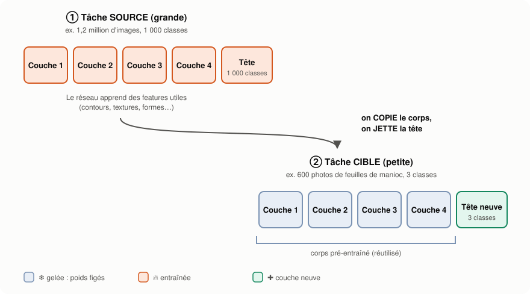
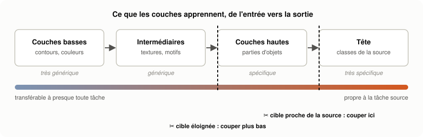
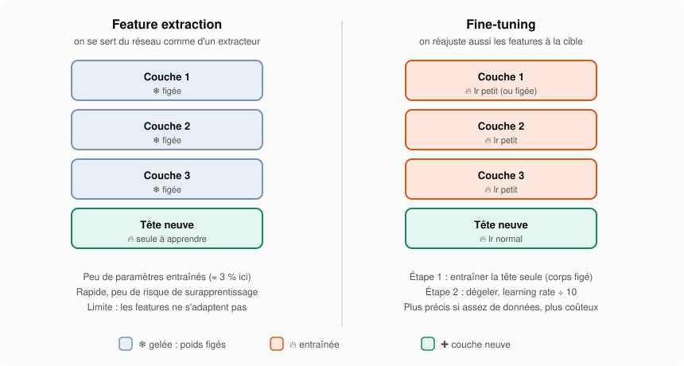
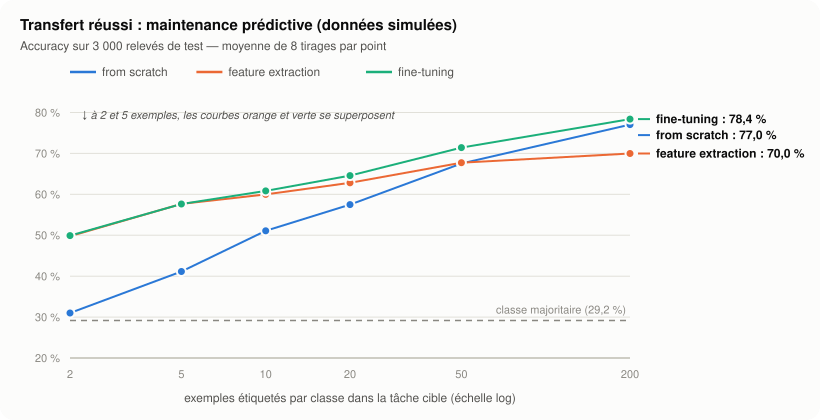
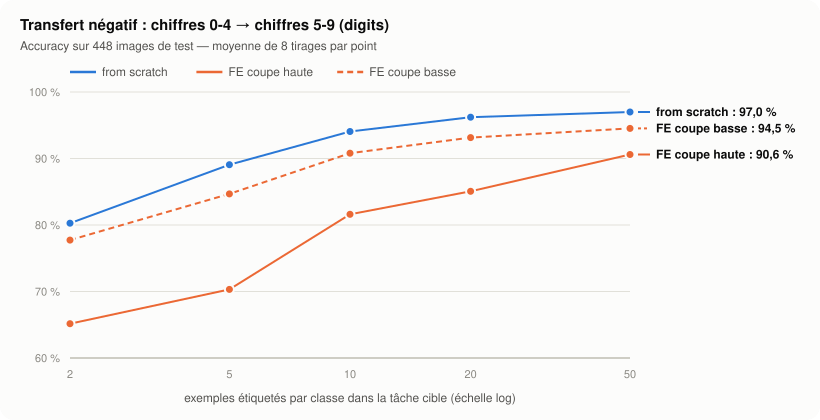
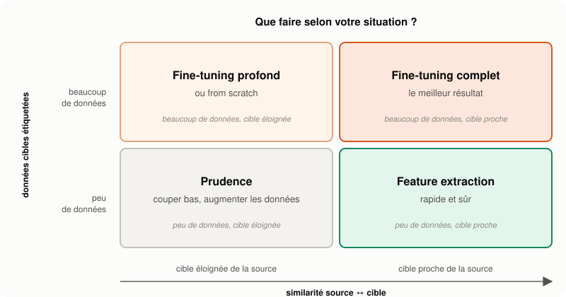

# 🔁 Feature Extraction vs Fine-Tuning — Cours Bootcamp Data Science

> **Module Data Science — Deep Learning** | Prérequis : cours "Forward & Backward Propagation" (`03-...md`), cours "Concevoir et entraîner des CNN" (`04-...md`, section 19)

---

## Table des matières

### Partie I — Le transfer learning
1. [Le problème : trop peu de données étiquetées](#1-le-problème--trop-peu-de-données-étiquetées)
2. [L'idée : réutiliser un réseau déjà entraîné](#2-lidée--réutiliser-un-réseau-déjà-entraîné)
3. [🧩 Pourquoi ça marche : la hiérarchie des features](#3--pourquoi-ça-marche--la-hiérarchie-des-features)
4. [Le vocabulaire du transfer learning](#4-le-vocabulaire-du-transfer-learning)

### Partie II — Les deux stratégies
5. [Feature extraction (extraction de caractéristiques)](#5-feature-extraction-extraction-de-caractéristiques)
6. [Fine-tuning (réglage fin)](#6-fine-tuning-réglage-fin)
7. [Feature extraction vs fine-tuning : la comparaison](#7-feature-extraction-vs-fine-tuning--la-comparaison)

### Partie III — L'expérience, chiffres à l'appui
8. [Le scénario : maintenance prédictive](#8-le-scénario--maintenance-prédictive)
9. [Un réseau dont on peut geler les couches](#9-un-réseau-dont-on-peut-geler-les-couches)
10. [Les données et le pré-entraînement](#10-les-données-et-le-pré-entraînement)
11. [From scratch, feature extraction, fine-tuning : les résultats](#11-from-scratch-feature-extraction-fine-tuning--les-résultats)
12. [🧩 L'effet de la richesse de la tâche source](#12--leffet-de-la-richesse-de-la-tâche-source)
13. [🧩 Quand le transfert échoue : le transfert négatif](#13--quand-le-transfert-échoue--le-transfert-négatif)

### Partie IV — Choisir et pratiquer
14. [Quelle stratégie choisir ?](#14-quelle-stratégie-choisir-)
15. [🧩 Les bonnes pratiques et les pièges](#15--les-bonnes-pratiques-et-les-pièges)
16. [🧩 Au-delà des images : texte, LLM et modèles pré-entraînés](#16--au-delà-des-images--texte-llm-et-modèles-pré-entraînés)
17. [🧩 De NumPy aux frameworks](#17--de-numpy-aux-frameworks)

### Partie V — Synthèse
18. [Conclusion](#18-conclusion)
19. [✅ Point de contrôle — Feature Extraction vs Fine-Tuning](#19--point-de-contrôle--feature-extraction-vs-fine-tuning)

> 🧩 = notion ajoutée parce qu'elle est indispensable pour comprendre ou pratiquer.

> ⚙️ **Environnement** : tout le code de ce cours utilise uniquement **NumPy et scikit-learn** — pas de TensorFlow ni de PyTorch. Il réutilise le réseau « from scratch » du cours 03, auquel on ajoute la possibilité de **geler** des couches. Tous les résultats affichés ont été obtenus en exécutant réellement le code (environ 1 min 30 sur un ordinateur portable) ; ils sont reproductibles à l'identique grâce aux graines aléatoires fixées.

---

# PARTIE I — LE TRANSFER LEARNING

## 1. Le problème : trop peu de données étiquetées

Un réseau de neurones profond a des milliers, voire des millions de paramètres. Pour les régler correctement à partir de zéro, il lui faut **beaucoup d'exemples étiquetés**. Or, dans la vraie vie, les étiquettes coûtent cher :

| Projet | Pourquoi les étiquettes sont rares |
|--------|------------------------------------|
| Diagnostic des maladies du manioc sur photo | il faut un agronome pour annoter chaque photo |
| Détection d'anomalies sur une nouvelle machine | les pannes sont rares, et la machine vient d'être installée |
| Classement des réclamations clients d'une banque | lire et étiqueter des milliers de messages prend des semaines |
| Analyse de radiographies | seul un radiologue peut annoter |

Entraîner un grand réseau « from scratch » (à partir de poids aléatoires) sur quelques centaines d'exemples mène presque toujours au **surapprentissage** : le réseau mémorise ses exemples au lieu d'apprendre.

> 🔑 **La question de ce cours** : peut-on profiter de ce qu'un réseau a déjà appris **ailleurs**, sur une grande tâche, pour résoudre **notre** petite tâche avec peu de données ?

---

## 2. L'idée : réutiliser un réseau déjà entraîné

Le **transfer learning** (apprentissage par transfert) consiste à partir d'un **modèle pré-entraîné** sur une grande tâche — la **tâche source** — pour l'adapter à une autre tâche — la **tâche cible**.



*Figure 1 — On copie le corps du réseau pré-entraîné, on jette sa tête (propre à la tâche source) et on pose une tête neuve pour la tâche cible.*

> 💡 **Analogie** : une comptable expérimentée qui rejoint une nouvelle entreprise ne réapprend pas la comptabilité. Elle réutilise tout son savoir général (le « corps ») et n'apprend que les règles propres à sa nouvelle entreprise (la « tête »). Si l'entreprise est très différente (une banque après une PME), elle devra aussi ajuster une partie de ses habitudes : c'est le fine-tuning.

Il existe deux grandes façons d'adapter le modèle :

| Stratégie | En une phrase |
|-----------|---------------|
| **Feature extraction** | on **gèle** le corps et on n'entraîne que la tête neuve |
| **Fine-tuning** | on entraîne la tête, puis on **dégèle** tout ou partie du corps pour l'ajuster doucement à la cible |

---

## 3. 🧩 Pourquoi ça marche : la hiérarchie des features

Un réseau profond construit ses représentations **couche après couche**, du plus simple au plus abstrait. Les travaux de Yosinski et ses coauteurs (*How transferable are features in deep neural networks?*, 2014) l'ont mesuré sur des CNN : les **premières couches** apprennent des features **générales** (contours, couleurs), qui se transfèrent presque à toute tâche, tandis que les **dernières couches** deviennent **spécifiques** à la tâche source.



*Figure 2 — Plus on monte dans le réseau, plus les features sont spécifiques à la tâche source. D'où la question clé : **où couper ?***

Conséquences pratiques :

1. **La tête est toujours remplacée** : elle prédit les classes de la source, qui ne sont pas celles de la cible.
2. **Plus la cible ressemble à la source, plus on peut garder de couches** (on coupe haut).
3. **Plus la cible est éloignée, plus on coupe bas**, en ne gardant que les features les plus générales.
4. **La tâche source doit être riche** : un réseau entraîné à distinguer 1 000 classes (ImageNet) apprend des features bien plus générales qu'un réseau entraîné à en distinguer 2. Nous le vérifierons à la section 12.

---

## 4. Le vocabulaire du transfer learning

| Terme | Définition |
|-------|------------|
| **Tâche source** | la grande tâche sur laquelle le modèle a été pré-entraîné (ex. ImageNet : 1,2 million d'images, 1 000 classes) |
| **Tâche cible** | votre tâche, généralement avec peu de données |
| **Modèle pré-entraîné** | le réseau entraîné sur la source, dont on réutilise les poids |
| **Corps** (*backbone*, *base*) | toutes les couches sauf la dernière : l'extracteur de features |
| **Tête** (*head*) | la ou les couches finales qui produisent la prédiction |
| **Geler** (*freeze*) | empêcher la mise à jour des poids d'une couche pendant l'entraînement |
| **Dégeler** (*unfreeze*) | autoriser à nouveau leur mise à jour |
| **Features / embeddings** | la sortie du corps : une représentation compacte et informative de l'entrée |

> 🔑 **Geler une couche, concrètement** : pendant la backpropagation, on calcule quand même le gradient qui **traverse** la couche (les couches situées en dessous peuvent en avoir besoin), mais on **n'applique pas** la mise à jour $W \leftarrow W - \eta\,\partial L/\partial W$ à ses poids. Ils restent exactement identiques.

---

# PARTIE II — LES DEUX STRATÉGIES

## 5. Feature extraction (extraction de caractéristiques)

### 📖 Principe

On utilise le corps pré-entraîné comme une **boîte noire figée** qui transforme chaque entrée en un vecteur de features. Seule la tête neuve apprend.

```
entrée ──► [ CORPS PRÉ-ENTRAÎNÉ — gelé ❄ ] ──► features ──► [ TÊTE NEUVE — entraînée 🔥 ] ──► prédiction
```

### 5.1 Deux façons de la mettre en œuvre

| Variante | Comment | Avantage |
|----------|---------|----------|
| **Geler le corps dans le réseau** | on entraîne le réseau complet avec les couches du corps gelées | une seule pièce, facile à servir |
| **Pré-calculer les features** | on passe toutes les données une fois dans le corps, on enregistre les vecteurs, puis on entraîne un modèle classique dessus (régression logistique, SVM, Random Forest) | très rapide : le corps ne tourne qu'**une** fois |

> 💡 La seconde variante montre que la feature extraction est **du ML classique sur de meilleures variables** : le réseau pré-entraîné fait le travail de *feature engineering* (cours 05 du module Machine Learning) à votre place.

### 5.2 Avantages et limites

| ✅ Avantages | ⚠️ Limites |
|-------------|-----------|
| Très peu de paramètres à entraîner → **faible risque de surapprentissage** | Les features ne s'adaptent **pas** à la cible : la performance **plafonne** |
| Rapide, peu de calcul (pas de backprop dans le corps) | Inadaptée si la cible est très éloignée de la source |
| Fonctionne avec **très peu** d'exemples | |

---

## 6. Fine-tuning (réglage fin)

### 📖 Principe

On part du réseau pré-entraîné avec une tête neuve, et on **continue l'entraînement du corps** sur la tâche cible, avec un **learning rate beaucoup plus petit**. Les features pré-entraînées servent de **point de départ** au lieu de poids aléatoires.

### 6.1 La recette en deux étapes

```
ÉTAPE 1 — la tête seule            ÉTAPE 2 — on dégèle
[ corps ❄ ] ──► [ tête 🔥 ]        [ corps 🔥 lr petit ] ──► [ tête 🔥 ]
learning rate normal                learning rate ÷ 10 à ÷ 100
```

> ⚠️ **Pourquoi commencer par la tête seule ?** Une tête neuve est **aléatoire** : au début, ses erreurs sont énormes. Si le corps est dégelé dès le départ, ces grosses erreurs remontent par la backpropagation et **détruisent** les features pré-entraînées avant que la tête n'ait appris quoi que ce soit. On stabilise d'abord la tête, puis on ajuste le corps.

### 6.2 Pourquoi un learning rate petit ?

Les poids pré-entraînés sont **déjà bons**. On veut les **ajuster**, pas les remplacer. Un grand learning rate ferait faire au réseau de grands pas qui l'éloigneraient de cette bonne solution. Dans l'expérience de ce cours, l'étape 2 utilise un learning rate **10 fois plus petit** que l'étape 1 ; avec un optimiseur Adam sur de grands CNN, on divise souvent par 100 (cours 04, section 19).

### 6.3 🧩 Combien de couches dégeler ?

| Situation | Que dégeler ? |
|-----------|---------------|
| Peu de données, cible proche | rien (feature extraction) ou seulement les dernières couches du corps |
| Données moyennes | les dernières couches du corps |
| Beaucoup de données, ou cible éloignée | tout le corps |

Deux techniques affinent ce réglage :

- **Learning rates différenciés** (*discriminative learning rates*) : un learning rate plus petit pour les couches basses (générales, à préserver) que pour les couches hautes (spécifiques, à adapter).
- **Dégel progressif** (*gradual unfreezing*) : on dégèle les couches une par une, du haut vers le bas, au fil des epochs.

Ces deux idées ont été popularisées par ULMFiT (Howard et Ruder, 2018), une méthode de transfer learning pour le texte.

### 6.4 🧩 Le risque : l'oubli catastrophique

En fine-tunant trop fort (learning rate trop grand, trop d'epochs, trop peu de données), le réseau peut **perdre** ce qu'il savait de la source — on parle d'**oubli catastrophique** (*catastrophic forgetting*) — et surapprendre ses quelques exemples cibles. Les remèdes : learning rate petit, **early stopping** sur un jeu de validation, et ne dégeler que les couches nécessaires.

---

## 7. Feature extraction vs fine-tuning : la comparaison



*Figure 3 — Les deux stratégies sur le même réseau. Le pourcentage de paramètres entraînés (≈ 3 %) est celui de l'expérience de la Partie III.*

| Critère | Feature extraction | Fine-tuning |
|---------|--------------------|-------------|
| Couches entraînées | la tête seule | la tête, puis tout ou partie du corps |
| Paramètres entraînés | très peu | beaucoup |
| Données nécessaires | très peu | un peu plus |
| Temps de calcul | faible | plus élevé |
| Risque de surapprentissage | faible | plus élevé (à surveiller) |
| Adaptation des features à la cible | aucune | oui |
| Performance quand les données augmentent | **plafonne** | continue de progresser |
| Quand la cible est éloignée de la source | souvent insuffisante | préférable |

> 🔑 **Le fine-tuning commence toujours par une feature extraction** (étape 1). Il ne peut donc pas faire *beaucoup* moins bien qu'elle, à condition d'utiliser un learning rate petit et de surveiller la validation : au pire, l'étape 2 n'apporte rien.

---

# PARTIE III — L'EXPÉRIENCE, CHIFFRES À L'APPUI

## 8. Le scénario : maintenance prédictive

### 📖 Le contexte

Une usine exploite depuis des années une **ancienne gamme de machines**. Chacune porte **50 capteurs** (vibrations, températures, pressions…). L'historique compte **20 000 relevés étiquetés** avec **30 états de fonctionnement** (normal, usure du roulement, désalignement, surchauffe…).

L'usine installe une **nouvelle gamme**. Les ingénieurs veulent reconnaître **5 nouveaux états**, mais n'ont que **quelques relevés étiquetés par état**, car ces états sont rares et l'annotation demande un expert.

La physique est la même : dans les deux gammes, les 50 capteurs sont pilotés par **les mêmes 4 facteurs cachés** (usure, charge, température ambiante, déséquilibre). La question : le réseau entraîné sur l'ancienne gamme peut-il aider ?

> ⚠️ **Honnêteté sur les données** : ces données sont **simulées**. Ce choix permet de contrôler exactement ce que les deux tâches ont en commun (les 4 facteurs cachés) et de reproduire l'expérience sans télécharger de grand jeu de données ni de modèle pré-entraîné. Les mécanismes observés sont ceux du transfer learning réel. La section 13 montre ensuite une expérience sur des **données réelles** (images de chiffres manuscrits), où le transfert **échoue**.

```
                    4 FACTEURS CACHÉS (la physique commune)
                     usure · charge · température · déséquilibre
                         │                        │
            ┌────────────┘                        └────────────┐
            ▼                                                  ▼
  ANCIENNE GAMME (source)                          NOUVELLE GAMME (cible)
  50 capteurs, 20 000 relevés                      50 capteurs, quelques relevés
  30 états étiquetés                               5 NOUVEAUX états
```

---

## 9. Un réseau dont on peut geler les couches

On reprend le réseau dense du cours 03 (forward, backward, descente de gradient), écrit cette fois pour un nombre quelconque de couches, avec une sortie **softmax** (plusieurs classes). Trois ajouts suffisent pour faire du transfer learning :

- `couches_gelees` dans `fit()` : les couches listées ne sont **pas mises à jour** ;
- `nouvelle_tete()` : remplace la couche de sortie par une couche neuve ;
- `tronquer()` : ne garde que les premières couches cachées (pour « couper plus bas »).

```python
import numpy as np
from sklearn.datasets import load_digits
from sklearn.model_selection import train_test_split


class ReseauDense:
    """Réseau dense : couches cachées ReLU + sortie softmax (forward/backward du cours 03)."""

    def __init__(self, tailles, seed=0):
        rng = np.random.default_rng(seed)
        self.W = [rng.normal(0, np.sqrt(2 / a), (a, b))              # initialisation He
                  for a, b in zip(tailles[:-1], tailles[1:])]
        self.b = [np.zeros((1, b)) for b in tailles[1:]]

    def forward(self, X):
        A = [X]
        for l, (W, b) in enumerate(zip(self.W, self.b)):
            Z = A[-1] @ W + b
            if l < len(self.W) - 1:
                A.append(np.maximum(0, Z))                           # ReLU
            else:
                Z = Z - Z.max(axis=1, keepdims=True)                 # softmax numériquement stable
                E = np.exp(Z)
                A.append(E / E.sum(axis=1, keepdims=True))
        return A

    def predict(self, X):
        return self.forward(X)[-1].argmax(axis=1)

    def fit(self, X, y, epochs=600, lr=0.3, couches_gelees=()):
        Y = np.eye(self.W[-1].shape[1])[y]                           # one-hot
        for _ in range(epochs):
            A = self.forward(X)
            dZ = (A[-1] - Y) / len(X)                                # softmax + entropie croisée : ŷ - y
            for l in reversed(range(len(self.W))):
                dW = A[l].T @ dZ
                db = dZ.sum(axis=0, keepdims=True)
                if l > 0:
                    dZ = (dZ @ self.W[l].T) * (A[l] > 0)             # l'erreur remonte (dérivée de ReLU)
                if l not in couches_gelees:                          # couche gelée : AUCUNE mise à jour
                    self.W[l] -= lr * dW
                    self.b[l] -= lr * db
        return self

    def nouvelle_tete(self, n_classes, seed=0):
        """Jette la couche de sortie et la remplace par une couche neuve (aléatoire)."""
        rng = np.random.default_rng(seed)
        n_in = self.W[-1].shape[0]
        self.W[-1] = rng.normal(0, np.sqrt(2 / n_in), (n_in, n_classes))
        self.b[-1] = np.zeros((1, n_classes))
        return self

    def tronquer(self, n_couches_gardees, n_classes, seed=0):
        """Ne garde que les n premières couches cachées, puis pose une tête neuve."""
        self.W = self.W[:n_couches_gardees] + [None]
        self.b = self.b[:n_couches_gardees] + [None]
        rng = np.random.default_rng(seed)
        n_in = self.W[-2].shape[1]
        self.W[-1] = rng.normal(0, np.sqrt(2 / n_in), (n_in, n_classes))
        self.b[-1] = np.zeros((1, n_classes))
        return self

    def copie(self):
        clone = ReseauDense.__new__(ReseauDense)
        clone.W = [w.copy() for w in self.W]
        clone.b = [b.copy() for b in self.b]
        return clone

    def n_parametres(self, couches=None):
        couches = range(len(self.W)) if couches is None else couches
        return int(sum(self.W[l].size + self.b[l].size for l in couches))
```

> 🔑 **Toute la différence entre les stratégies tient dans une ligne** : `if l not in couches_gelees`. Le gradient continue de **traverser** une couche gelée (ligne `dZ = ...`), mais ses poids ne bougent pas.

---

## 10. Les données et le pré-entraînement

### 10.1 Simuler les deux gammes

```python
# Une « physique » commune : 4 facteurs cachés pilotent les 50 capteurs de TOUTES les machines
GAIN = 1.5
rng0 = np.random.default_rng(0)
A1 = rng0.normal(0, 1, (4, 32))
A2 = rng0.normal(0, 1 / np.sqrt(32), (32, 50))

def mesurer(Z, rng, bruit=0.1):
    """50 mesures de capteurs, fonction (très) non linéaire des 4 facteurs cachés Z."""
    return np.tanh(np.sin(GAIN * (Z @ A1)) @ A2 * 2) + rng.normal(0, bruit, (len(Z), 50))

def etiquettes(Z, n_classes, seed):
    """Un « état de la machine » = une région de l'espace des facteurs cachés."""
    P = np.random.default_rng(seed).normal(0, 1, (Z.shape[1], n_classes))
    return np.argmax(Z @ P, axis=1)

rng = np.random.default_rng(1)
Z_src = rng.normal(0, 1, (20000, 4))                     # ancienne gamme : 20 000 relevés
X_src = mesurer(Z_src, rng)
Z_cib = rng.normal(0, 1, (6000, 4))                      # nouvelle gamme
X_cib = mesurer(Z_cib, rng)
y_cib = etiquettes(Z_cib, 5, seed=20)                    # 5 NOUVEAUX états à reconnaître
X_pool, y_pool = X_cib[:3000], y_cib[:3000]              # où l'on piochera les rares étiquettes
X_test, y_test = X_cib[3000:], y_cib[3000:]              # 3 000 relevés de test, jamais vus

print("Répartition du test :", np.bincount(y_test))
print(f"Classe majoritaire : {np.bincount(y_test).max() / len(y_test):.1%}")
```

```
Répartition du test : [700 696 352 377 875]
Classe majoritaire : 29.2%
```

> 💡 **Le repère à battre** : un modèle qui répondrait toujours l'état le plus fréquent aurait **29,2 %** d'accuracy (et le hasard, avec 5 classes, environ 20 %).

### 10.2 Pré-entraîner sur l'ancienne gamme

```python
T = [50, 64, 32]                                         # 50 capteurs -> 64 -> 32 features
y_src = etiquettes(Z_src, 30, seed=10)                   # tâche source riche : 30 états
pre = ReseauDense(T + [30], seed=0).fit(X_src, y_src, epochs=2000, lr=0.3)
print(f"Modèle source : accuracy {np.mean(pre.predict(X_src) == y_src):.3f} sur ses 30 états")

m = pre.copie().nouvelle_tete(5)
print(f"Paramètres : {m.n_parametres()} au total, dont {m.n_parametres([2])} dans la tête")
```

```
Modèle source : accuracy 0.915 sur ses 30 états
Paramètres : 5509 au total, dont 165 dans la tête
```

En feature extraction, on n'entraîne donc que **165 paramètres sur 5 509**, soit **3,0 %**.

---

## 11. From scratch, feature extraction, fine-tuning : les résultats

### 11.1 Le protocole

Pour chaque taille *n* (de 2 à 200 relevés étiquetés **par état**), on tire *n* exemples par classe dans la nouvelle gamme, on entraîne les trois stratégies, et on mesure l'accuracy sur les **3 000 relevés de test**. Comme un tirage de 2 exemples peut être chanceux ou malchanceux, on répète **8 tirages** et on rapporte la moyenne ± l'écart-type.

| Stratégie | Point de départ | Couches entraînées |
|-----------|-----------------|--------------------|
| **From scratch** | poids aléatoires | toutes, pendant 600 epochs |
| **Feature extraction** | corps pré-entraîné + tête neuve | la tête seule, pendant 600 epochs |
| **Fine-tuning** | corps pré-entraîné + tête neuve | la tête seule (300 epochs), puis tout avec un lr ÷ 10 (300 epochs) |

```python
def strategies(pre, T, n_cls, lr, lr_ft, gel):
    def from_scratch(Xt, yt, s):
        return ReseauDense(T + [n_cls], seed=100 + s).fit(Xt, yt, epochs=600, lr=lr)

    def feature_extraction(Xt, yt, s):
        m = pre.copie().nouvelle_tete(n_cls, seed=100 + s)
        return m.fit(Xt, yt, epochs=600, lr=lr, couches_gelees=gel)       # seule la tête apprend

    def fine_tuning(Xt, yt, s):
        m = pre.copie().nouvelle_tete(n_cls, seed=100 + s)
        m.fit(Xt, yt, epochs=300, lr=lr, couches_gelees=gel)             # étape 1 : la tête seule
        return m.fit(Xt, yt, epochs=300, lr=lr_ft)                       # étape 2 : tout, lr ÷ 10

    return {"from scratch": from_scratch, "feature extraction": feature_extraction,
            "fine-tuning": fine_tuning}


def evaluer(strats, X_pool, y_pool, X_test, y_test, n_cls, tailles_n, n_tirages=8):
    """Pour chaque n : tire n exemples par classe, entraîne, mesure l'accuracy (8 tirages)."""
    res = {nom: {} for nom in strats}
    for n in tailles_n:
        for nom, f in strats.items():
            accs = []
            for s in range(n_tirages):
                r = np.random.default_rng(s)
                idx = np.concatenate([r.choice(np.where(y_pool == k)[0], n, replace=False)
                                      for k in range(n_cls)])
                modele = f(X_pool[idx], y_pool[idx], s)
                accs.append(np.mean(modele.predict(X_test) == y_test))
            res[nom][n] = (np.mean(accs), np.std(accs))
        print(f"n = {n:3d} / classe | " + " | ".join(
            f"{k} {res[k][n][0]:.1%} ± {res[k][n][1]:.1%}" for k in strats))
    return res

res_30 = evaluer(strategies(pre, T, 5, lr=0.3, lr_ft=0.03, gel=(0, 1)),
                 X_pool, y_pool, X_test, y_test, 5, [2, 5, 10, 20, 50, 200])
```

```
n =   2 / classe | from scratch 31.0% ± 4.1% | feature extraction 49.8% ± 4.1% | fine-tuning 49.9% ± 4.1%
n =   5 / classe | from scratch 41.1% ± 3.0% | feature extraction 57.7% ± 3.6% | fine-tuning 57.6% ± 3.5%
n =  10 / classe | from scratch 51.1% ± 3.3% | feature extraction 60.0% ± 4.7% | fine-tuning 60.8% ± 4.6%
n =  20 / classe | from scratch 57.5% ± 1.6% | feature extraction 62.8% ± 2.3% | fine-tuning 64.6% ± 2.1%
n =  50 / classe | from scratch 67.5% ± 1.2% | feature extraction 67.7% ± 1.6% | fine-tuning 71.4% ± 1.4%
n = 200 / classe | from scratch 77.0% ± 1.2% | feature extraction 70.0% ± 1.5% | fine-tuning 78.4% ± 0.4%
```



*Figure 4 — Les mêmes résultats en graphique (axe horizontal en échelle logarithmique).*

### 11.2 Ce que montrent les résultats

1. **Avec très peu de données, le transfert écrase l'apprentissage from scratch.** Avec 2 relevés par état, la feature extraction atteint **49,8 %** contre **31,0 %** : à peine au-dessus de la classe majoritaire pour le réseau from scratch, qui n'a que 10 exemples pour régler 5 509 paramètres.
2. **Avec peu de données, fine-tuning ≈ feature extraction.** À 2 et 5 exemples par état, l'étape 2 du fine-tuning n'apporte rien : il n'y a pas assez d'exemples pour améliorer les features sans risque.
3. **Dès 20 exemples, le fine-tuning prend l'avantage** (64,6 % contre 62,8 %), et l'écart grandit (71,4 % contre 67,7 % à 50).
4. **La feature extraction plafonne.** Elle passe de 67,7 % à seulement 70,0 % entre 50 et 200 exemples : ses features figées ne contiennent pas toute l'information utile à la cible, et plus de données n'y change rien.
5. **Avec beaucoup de données, l'apprentissage from scratch rattrape son retard** : à 200 exemples, il dépasse la feature extraction (77,0 % contre 70,0 %) et se rapproche du fine-tuning (78,4 %).

> 🔑 **La règle à retenir** : *le transfert vaut le plus quand les données sont rares*. La feature extraction est imbattable en rapport qualité/coût avec très peu d'exemples ; le fine-tuning est le meilleur choix dès qu'on a quelques dizaines d'exemples par classe ; avec beaucoup de données, l'avantage du transfert se réduit.

---

## 12. 🧩 L'effet de la richesse de la tâche source

Pourquoi ImageNet a-t-il 1 000 classes et non 10 ? Refaisons l'expérience avec la **même** ancienne gamme et les **mêmes** 20 000 relevés, mais un pré-entraînement sur seulement **6 états** au lieu de 30.

```python
y_src6 = etiquettes(Z_src, 6, seed=10)                   # même source, mais seulement 6 états
pre6 = ReseauDense(T + [6], seed=0).fit(X_src, y_src6, epochs=2000, lr=0.3)
res_6 = evaluer(strategies(pre6, T, 5, lr=0.3, lr_ft=0.03, gel=(0, 1)),
                X_pool, y_pool, X_test, y_test, 5, [2, 5, 20, 50])
```

```
n =   2 / classe | from scratch 31.0% ± 4.1% | feature extraction 40.1% ± 5.5% | fine-tuning 40.1% ± 5.5%
n =   5 / classe | from scratch 41.1% ± 3.0% | feature extraction 48.4% ± 3.7% | fine-tuning 49.1% ± 3.5%
n =  20 / classe | from scratch 57.5% ± 1.6% | feature extraction 54.2% ± 2.6% | fine-tuning 59.2% ± 2.4%
n =  50 / classe | from scratch 67.5% ± 1.2% | feature extraction 61.9% ± 1.1% | fine-tuning 68.0% ± 0.8%
```

| Exemples / classe | Feature extraction, source **30** états | Feature extraction, source **6** états | From scratch |
|---|---|---|---|
| 2 | **49,8 %** | 40,1 % | 31,0 % |
| 5 | **57,7 %** | 48,4 % | 41,1 % |
| 20 | **62,8 %** | 54,2 % | 57,5 % |
| 50 | **67,7 %** | 61,9 % | 67,5 % |

Avec une source pauvre, le gain du transfert fond et, dès 20 exemples, la feature extraction devient **moins bonne** que l'apprentissage from scratch.

> 🔑 **Explication** : pour distinguer 30 états, le réseau source doit capter une grande partie de l'information des 4 facteurs cachés. Pour n'en distinguer que 6, il lui suffit d'en garder une petite partie : ses features sont plus **étroites** et servent moins à d'autres tâches. *Une tâche source riche et variée produit des features générales.* C'est pour cela que les modèles pré-entraînés de référence le sont sur d'immenses jeux de données variés.

---

## 13. 🧩 Quand le transfert échoue : le transfert négatif

### 13.1 L'expérience, sur données réelles

Jeu `digits` de scikit-learn : 1 797 images de chiffres manuscrits de 8 × 8 pixels. On pré-entraîne sur les chiffres **0 à 4** (901 images) et on transfère vers les chiffres **5 à 9**.

```python
X, y = load_digits(return_X_y=True)
X = X / 16.0
X_s, y_s = X[y < 5], y[y < 5]                            # source : chiffres 0 à 4
X_c, y_c = X[y >= 5], y[y >= 5] - 5                      # cible : chiffres 5 à 9 (renumérotés 0-4)
Xp, Xt, yp, yt = train_test_split(X_c, y_c, test_size=0.5, random_state=0, stratify=y_c)

Td = [64, 64, 32]
pre_d = ReseauDense(Td + [5], seed=0).fit(X_s, y_s, epochs=1500, lr=0.2)

print("Coupe haute : on garde les 2 couches cachées (32 features)")
res_haute = evaluer(strategies(pre_d, Td, 5, 0.2, 0.02, gel=(0, 1)), Xp, yp, Xt, yt, 5, [2, 5, 10, 20, 50])

print("Coupe basse : on ne garde que la 1re couche cachée (64 features)")
pre_bas = pre_d.copie().tronquer(1, 5)
res_basse = evaluer(strategies(pre_bas, [64, 64], 5, 0.2, 0.02, gel=(0,)), Xp, yp, Xt, yt, 5, [2, 5, 10, 20, 50])
```

```
Coupe haute : on garde les 2 couches cachées (32 features)
n =   2 / classe | from scratch 80.3% ± 4.5% | feature extraction 65.2% ± 3.7% | fine-tuning 68.4% ± 3.6%
n =   5 / classe | from scratch 89.1% ± 1.9% | feature extraction 70.3% ± 2.8% | fine-tuning 77.0% ± 3.0%
n =  10 / classe | from scratch 94.1% ± 1.4% | feature extraction 81.6% ± 2.5% | fine-tuning 88.4% ± 1.5%
n =  20 / classe | from scratch 96.2% ± 0.7% | feature extraction 85.1% ± 2.2% | fine-tuning 92.1% ± 1.7%
n =  50 / classe | from scratch 97.0% ± 0.6% | feature extraction 90.6% ± 1.3% | fine-tuning 95.3% ± 0.7%
Coupe basse : on ne garde que la 1re couche cachée (64 features)
n =   2 / classe | from scratch 82.0% ± 5.5% | feature extraction 77.7% ± 3.1% | fine-tuning 78.6% ± 3.3%
n =   5 / classe | from scratch 89.8% ± 2.2% | feature extraction 84.7% ± 2.4% | fine-tuning 86.1% ± 2.5%
n =  10 / classe | from scratch 94.6% ± 0.9% | feature extraction 90.8% ± 1.1% | fine-tuning 92.0% ± 1.2%
n =  20 / classe | from scratch 96.2% ± 0.9% | feature extraction 93.1% ± 0.5% | fine-tuning 94.2% ± 0.9%
n =  50 / classe | from scratch 97.2% ± 0.8% | feature extraction 94.5% ± 0.3% | fine-tuning 95.5% ± 0.3%
```



*Figure 5 — Sur `digits`, le transfert fait **moins bien** que l'apprentissage from scratch, quelle que soit la quantité de données. Couper plus bas (pointillés) limite les dégâts.*

### 13.2 Pourquoi le transfert échoue ici

On parle de **transfert négatif** quand réutiliser un modèle pré-entraîné donne de **moins bons** résultats que partir de zéro. Les trois conditions du succès (section 3) sont réunies… à l'envers :

| Condition du succès | Capteurs (succès) | Digits (échec) |
|---------------------|-------------------|----------------|
| Source **beaucoup plus grande** que la cible | 20 000 relevés source | 901 images source, autant que la cible |
| Source **riche** | 30 états | 5 chiffres seulement |
| Cible **difficile** à partir des entrées brutes | les capteurs mélangent les facteurs de façon très non linéaire | des pixels 8 × 8 propres suffisent : from scratch atteint 80 % avec 2 images par chiffre |

Le réseau source a appris des features **spécialisées** pour distinguer 0, 1, 2, 3 et 4. Pour reconnaître un 8 ou un 9, ces features sont moins informatives que les pixels eux-mêmes : en les figeant, on **perd** de l'information.

### 13.3 Couper plus bas limite les dégâts

Avec la coupe **basse** (on ne garde que la 1re couche cachée, plus générale), la feature extraction passe de **70,3 % à 84,7 %** à 5 exemples par chiffre. Le transfert reste moins bon que from scratch (89,8 %), mais l'écart se réduit nettement. C'est la figure 2 vérifiée : **les couches basses se transfèrent mieux que les couches hautes**.

> ⚠️ **La leçon** : le transfer learning n'est **pas magique**. Comparez toujours votre modèle transféré à une **baseline from scratch** (et à un modèle classique simple) sur un jeu de validation. Si le transfert ne fait pas mieux, ne l'utilisez pas.

---

# PARTIE IV — CHOISIR ET PRATIQUER

## 14. Quelle stratégie choisir ?

Deux questions suffisent : **combien de données étiquetées avez-vous ?** et **la cible ressemble-t-elle à la source ?**



*Figure 6 — La matrice de décision du transfer learning.*

| Situation | Stratégie | Pourquoi |
|-----------|-----------|----------|
| Peu de données, cible proche | **feature extraction** | les features conviennent déjà ; entraîner plus risquerait le surapprentissage |
| Beaucoup de données, cible proche | **fine-tuning complet** | assez de données pour ajuster les features sans les abîmer |
| Peu de données, cible éloignée | **prudence** : couper bas, augmenter les données, comparer à une baseline | risque de transfert négatif |
| Beaucoup de données, cible éloignée | **fine-tuning profond**, ou entraînement from scratch | les features de la source servent peu ; les données suffisent |

**La démarche pratique, dans l'ordre :**

```
1. Établir une BASELINE simple (modèle classique, ou petit réseau from scratch)
2. Essayer la FEATURE EXTRACTION            → rapide, souvent déjà très bon
3. Si assez de données : FINE-TUNING en 2 étapes (tête seule, puis dégel avec lr petit)
4. Comparer les trois sur le MÊME jeu de validation, garder le meilleur
5. Évaluer UNE SEULE FOIS le modèle retenu sur le jeu de test
```

---

## 15. 🧩 Les bonnes pratiques et les pièges

| Piège | Conséquence | Bonne pratique |
|-------|-------------|----------------|
| Prétraiter les entrées autrement que pendant le pré-entraînement | les features ne veulent plus rien dire | appliquer **exactement** le prétraitement du modèle pré-entraîné (taille d'image, normalisation) |
| Dégeler le corps dès le départ | une tête aléatoire détruit les features | **tête seule d'abord**, puis dégel |
| Learning rate trop grand en fine-tuning | oubli catastrophique | diviser le learning rate par 10 à 100 |
| Aucun jeu de validation | impossible de voir le surapprentissage | validation + **early stopping** |
| Évaluer sur des données vues pendant l'entraînement | score trompeur | split train / validation / test **avant** tout (cours Train/Test Split) |
| Couches de BatchNorm en mode entraînement pendant le fine-tuning | statistiques de normalisation abîmées | les laisser en mode inférence (cours 04, section 19) |
| Ne pas comparer à une baseline | transfert négatif non détecté | toujours une baseline (section 13) |
| Classes déséquilibrées dans la cible | modèle biaisé vers la classe majoritaire | échantillonnage stratifié, métriques adaptées (F1, cours Métriques) |

> 💡 **Augmentation de données** : avec peu d'images, créer des variantes (rotations, recadrages, variations de luminosité) multiplie les exemples à moindre coût. Elle se combine très bien avec le transfer learning (cours 04, section 18).

---

## 16. 🧩 Au-delà des images : texte, LLM et modèles pré-entraînés

Le transfer learning est devenu **la façon standard** de faire du Deep Learning, bien au-delà de la vision.

| Domaine | Modèle pré-entraîné typique | Feature extraction | Fine-tuning |
|---------|-----------------------------|--------------------|-------------|
| **Images** | CNN pré-entraînés sur ImageNet (ResNet, MobileNet, EfficientNet) | vecteur de features de l'image → classifieur | réentraîner les dernières couches |
| **Texte** | BERT (pré-entraîné en 2018 sur de grands corpus de textes anglais) et ses variantes | *embeddings* de phrases → régression logistique | ajouter une tête de classification et fine-tuner |
| **Grands modèles de langage (LLM)** | modèles de type Claude, GPT, Llama | *embeddings* pour la recherche documentaire | fine-tuning sur des exemples de la tâche |
| **Audio** | modèles de reconnaissance vocale pré-entraînés | représentation du son → classifieur | adaptation à un accent, une langue, un vocabulaire |

### 16.1 Le cas des LLM : trois niveaux d'adaptation

```
COÛT ET EFFORT CROISSANTS ──────────────────────────────────────────────►
1. Prompting           2. Embeddings (+ RAG)          3. Fine-tuning
   on décrit la tâche     feature extraction :           on ajuste les poids
   dans la consigne       on encode des documents        sur ses propres exemples
   (aucun poids modifié)  et on cherche les plus proches
```

> 💡 **Fine-tuning efficace (PEFT, LoRA)** : fine-tuner tous les milliards de paramètres d'un LLM coûte très cher. Des méthodes comme **LoRA** (*Low-Rank Adaptation*, Hu et coauteurs, 2021) **gèlent** les poids d'origine et n'entraînent que de petites matrices ajoutées à côté : souvent bien moins de 1 % des paramètres. C'est l'idée même de ce cours — geler l'essentiel, entraîner peu — appliquée aux plus grands modèles.

### 16.2 Où trouver des modèles pré-entraînés

| Source | Contenu |
|--------|---------|
| **Hugging Face Hub** | des centaines de milliers de modèles (texte, image, audio) |
| **Keras Applications** | CNN pré-entraînés sur ImageNet, prêts à l'emploi (cours 04) |
| **torchvision / timm** | CNN et Transformers de vision pour PyTorch |

> ⚠️ **Avant de réutiliser un modèle**, vérifiez sa **licence** (usage commercial autorisé ?), ses **données d'entraînement** (sont-elles proches de votre contexte ? un modèle entraîné sur des visages européens peut moins bien fonctionner sur des visages africains) et ses **biais connus**. Le modèle pré-entraîné transmet ce qu'il sait… et ses défauts.

---

## 17. 🧩 De NumPy aux frameworks

Ce cours a tout codé en NumPy pour **voir** le mécanisme. Dans un framework, les mêmes opérations tiennent en une ligne. Le tableau ci-dessous donne la correspondance ; le code complet en Keras se trouve dans le cours 04 (section 19) et sera vu avec TensorFlow.

| Opération | Dans ce cours (NumPy) | Keras | PyTorch |
|-----------|-----------------------|-------|---------|
| Charger un corps pré-entraîné | `pre.copie()` | `keras.applications.MobileNetV2(include_top=False, weights="imagenet")` | `torchvision.models.resnet18(weights=...)` |
| Remplacer la tête | `nouvelle_tete(n)` | empiler une nouvelle couche `Dense(n, activation="softmax")` | remplacer `model.fc` |
| Geler le corps | `couches_gelees=(0, 1)` | `base.trainable = False` | `param.requires_grad = False` |
| Dégeler | `fit(...)` sans `couches_gelees` | `base.trainable = True`, puis recompiler | `param.requires_grad = True` |
| Learning rate de fine-tuning | `lr_ft = lr / 10` | `Adam(1e-5)` | `torch.optim.Adam(..., lr=1e-5)` |

---

# PARTIE V — SYNTHÈSE

## 18. Conclusion

### 🎓 Ce qu'il faut absolument retenir

1. **Le transfer learning réutilise un réseau pré-entraîné** sur une grande tâche source pour résoudre une tâche cible avec peu de données. On garde le **corps**, on remplace la **tête**.

2. **Il marche parce que les features sont hiérarchiques** : les couches basses apprennent des features générales, les couches hautes des features spécifiques à la source.

3. **Feature extraction** : corps **gelé**, seule la tête apprend. Peu de paramètres, rapide, très efficace avec très peu de données — mais la performance **plafonne**.

4. **Fine-tuning** : tête seule d'abord, puis dégel du corps avec un **learning rate 10 à 100 fois plus petit**. Plus coûteux, plus précis dès qu'on a quelques dizaines d'exemples par classe.

5. **L'expérience l'a montré** : avec 2 exemples par classe, la feature extraction passe de 31,0 % (from scratch) à 49,8 % ; le fine-tuning est le meilleur à toutes les tailles (78,4 % à 200 exemples) ; la feature extraction plafonne à 70 %, et l'apprentissage from scratch la dépasse quand les données abondent.

6. **Le transfert suppose une source grande, riche et liée à la cible.** Une source pauvre réduit le gain (section 12) ; une source trop spécialisée ou une cible trop facile mène au **transfert négatif** (section 13).

7. **Où couper compte** : plus la cible est éloignée, plus on coupe bas.

8. **Toujours comparer à une baseline from scratch** sur un jeu de validation : c'est la seule façon de savoir si le transfert aide vraiment.

### 🧭 Le mémo en une image

```
┌──────────────────────────────────────────────────────────────────────────┐
│  PEU DE DONNÉES  ──►  FEATURE EXTRACTION   corps ❄ gelé · tête 🔥        │
│  PLUS DE DONNÉES ──►  FINE-TUNING          tête seule, puis tout, lr ÷10  │
│  CIBLE ÉLOIGNÉE  ──►  couper plus BAS (features générales)                │
│  TOUJOURS        ──►  comparer à une baseline from scratch                │
│                                                                            │
│  Le transfert aide si : source GRANDE · source RICHE · tâches LIÉES       │
└──────────────────────────────────────────────────────────────────────────┘
```

> 🔑 **En une phrase** : *la feature extraction emprunte les connaissances d'un autre modèle telles quelles, le fine-tuning les adapte ; les deux ne valent que si ces connaissances concernent vraiment votre problème.*

---

## 19. ✅ Point de contrôle — Feature Extraction vs Fine-Tuning

### 🧠 Questions de compréhension

<details>
<summary><b>1. Qu'est-ce que le transfer learning, et quel problème résout-il ?</b></summary>

Réutiliser un modèle pré-entraîné sur une grande tâche source pour une tâche cible. Il résout le manque de données étiquetées : au lieu de régler des milliers de paramètres à partir de poids aléatoires avec peu d'exemples, on part de features déjà apprises.
</details>

<details>
<summary><b>2. Pourquoi remplace-t-on toujours la tête du modèle pré-entraîné ?</b></summary>

Parce qu'elle prédit les classes de la **source** (par exemple les 1 000 classes d'ImageNet), qui ne sont pas celles de la cible. Son nombre de sorties et sa signification ne conviennent pas.
</details>

<details>
<summary><b>3. Que signifie « geler » une couche, au niveau de la backpropagation ?</b></summary>

Ses poids ne sont **pas mis à jour**. Le gradient la traverse quand même (les couches inférieures peuvent en avoir besoin), mais on n'applique pas $W \leftarrow W - \eta\,\partial L/\partial W$ à cette couche. Dans le code du cours : `if l not in couches_gelees`.
</details>

<details>
<summary><b>4. Quelle est la différence entre feature extraction et fine-tuning ?</b></summary>

En **feature extraction**, le corps reste gelé et seule la tête neuve apprend. En **fine-tuning**, on entraîne d'abord la tête, puis on dégèle tout ou partie du corps pour l'ajuster à la cible avec un petit learning rate.
</details>

<details>
<summary><b>5. Pourquoi entraîner la tête seule avant de dégeler le corps ?</b></summary>

Une tête neuve est aléatoire et produit de grosses erreurs au début. Si le corps était dégelé, ces erreurs remonteraient par la backpropagation et détruiraient les features pré-entraînées. On stabilise d'abord la tête.
</details>

<details>
<summary><b>6. Pourquoi utiliser un learning rate plus petit pendant le fine-tuning ?</b></summary>

Les poids pré-entraînés sont déjà bons : on veut les **ajuster** légèrement, pas les remplacer. Un grand learning rate les éloignerait de la bonne solution (oubli catastrophique).
</details>

<details>
<summary><b>7. Dans l'expérience des capteurs, pourquoi le fine-tuning n'apporte-t-il rien à 2 et 5 exemples par classe ?</b></summary>

Avec si peu d'exemples, il n'y a pas assez d'information pour améliorer les features du corps sans risque : l'étape 2 change très peu le modèle obtenu à l'étape 1 (qui est une feature extraction). Les deux stratégies donnent donc le même résultat (49,8 % / 49,9 % à 2 exemples).
</details>

<details>
<summary><b>8. Pourquoi la feature extraction plafonne-t-elle vers 70 % ?</b></summary>

Ses features sont figées : elles ne contiennent pas toute l'information utile pour les 5 nouveaux états. Ajouter des exemples n'aide que la tête, pas les features. Le fine-tuning, lui, adapte les features et continue de progresser (78,4 % à 200 exemples).
</details>

<details>
<summary><b>9. Pourquoi un pré-entraînement sur 30 états transfère-t-il mieux qu'un pré-entraînement sur 6 ?</b></summary>

Pour distinguer 30 états, le réseau doit capter beaucoup plus d'information sur les facteurs cachés : ses features sont plus **générales**. Avec 6 états, il garde une petite partie de l'information, et ses features servent moins à d'autres tâches.
</details>

<details>
<summary><b>10. Qu'est-ce que le transfert négatif ? Donnez ses causes dans l'expérience digits.</b></summary>

Le transfert est négatif quand le modèle transféré fait **moins bien** que l'apprentissage from scratch. Sur digits : une source petite (901 images) et pauvre (5 chiffres), des features spécialisées sur 0-4, et une cible facile à partir des pixels bruts.
</details>

<details>
<summary><b>11. Pourquoi « couper plus bas » a-t-il réduit les dégâts sur digits ?</b></summary>

Les couches basses apprennent des features plus **générales**, moins liées aux chiffres 0 à 4. En ne gardant que la 1re couche cachée, on conserve davantage d'information utile aux chiffres 5 à 9 (84,7 % au lieu de 70,3 % à 5 exemples).
</details>

<details>
<summary><b>12. Vous avez 150 photos de feuilles de cacao réparties en 3 classes et un CNN pré-entraîné sur ImageNet. Quelle stratégie, et comment la vérifier ?</b></summary>

Peu de données, cible raisonnablement proche (des photos naturelles) : commencer par la **feature extraction**, puis tester un **fine-tuning** des dernières couches avec un learning rate très petit et un early stopping. Comparer les deux à une **baseline** sur le même jeu de validation, et n'évaluer qu'une fois sur le test.
</details>

<details>
<summary><b>13. Quel lien entre ce cours et LoRA pour les grands modèles de langage ?</b></summary>

LoRA applique le même principe : **geler** l'essentiel du modèle pré-entraîné et n'entraîner qu'une petite fraction de paramètres (de petites matrices ajoutées). C'est un fine-tuning efficace, à mi-chemin entre feature extraction et fine-tuning complet.
</details>

### 🛠️ Exercices pratiques

1. **Learning rate du fine-tuning** : dans le bloc des stratégies, remplacez `lr_ft=0.03` par `lr_ft=0.3` (le même learning rate qu'à l'étape 1). Relancez l'évaluation sur les capteurs. Que devient l'avantage du fine-tuning à 50 et 200 exemples ? Reliez votre observation à l'oubli catastrophique.
2. **Fine-tuning sans étape 1** : écrivez une stratégie `fine_tuning_direct` qui dégèle tout dès le départ (une seule étape de 600 epochs avec `lr_ft`). Comparez-la au fine-tuning en deux étapes.
3. **Feature extraction avec un modèle classique** : calculez les features du corps (`pre.forward(X)[-2]`) pour les exemples cibles, puis entraînez une `LogisticRegression` de scikit-learn dessus. Comparez à la feature extraction du cours.
4. **Couper au bon endroit** : sur les capteurs, essayez une coupe basse (`pre.copie().tronquer(1, 5)`, avec `T = [50, 64]` et `gel=(0,)`). Est-ce mieux ou moins bien que la coupe haute ? Pourquoi, d'après la section 12 ?

---

*📘 Module Data Science — Feature Extraction vs Fine-Tuning | Bootcamp Data Science*
