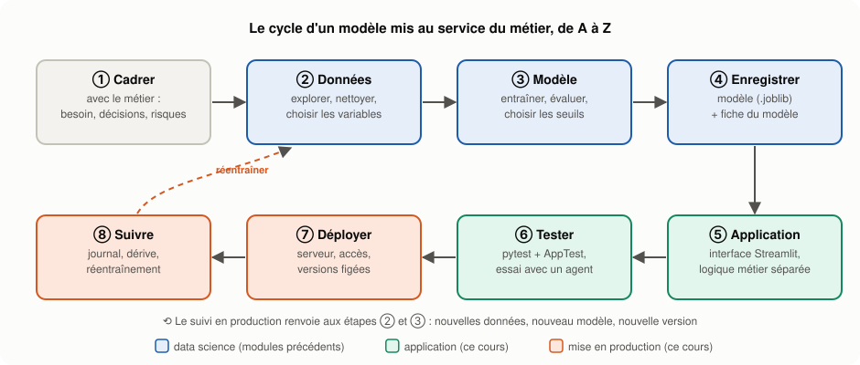
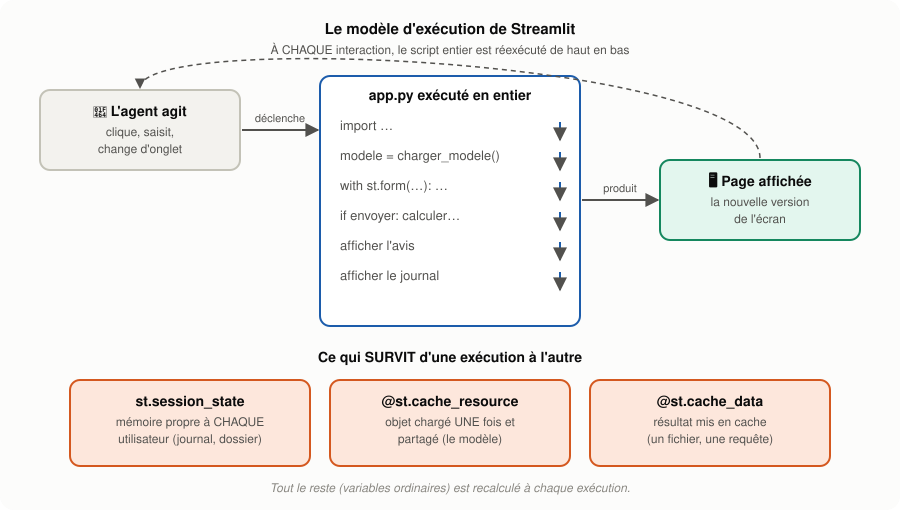
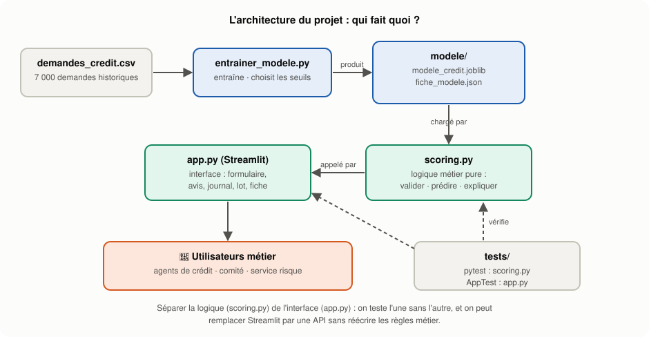
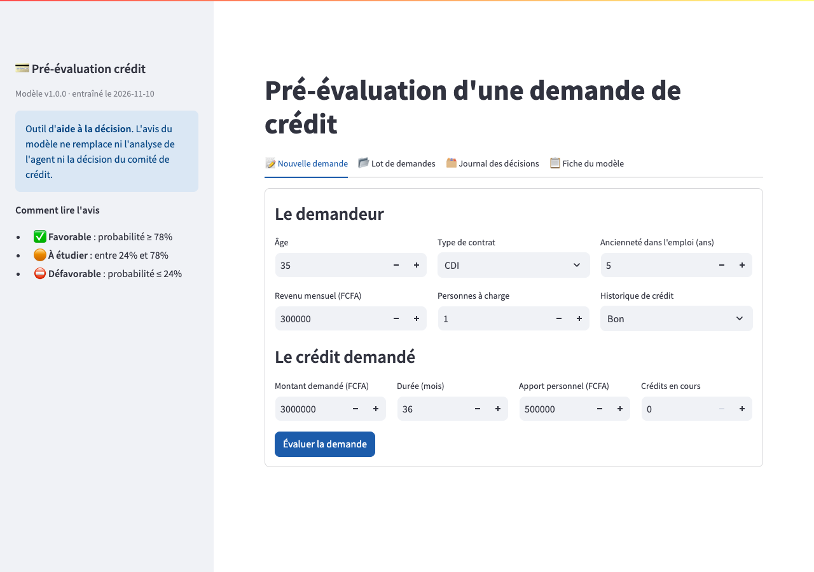
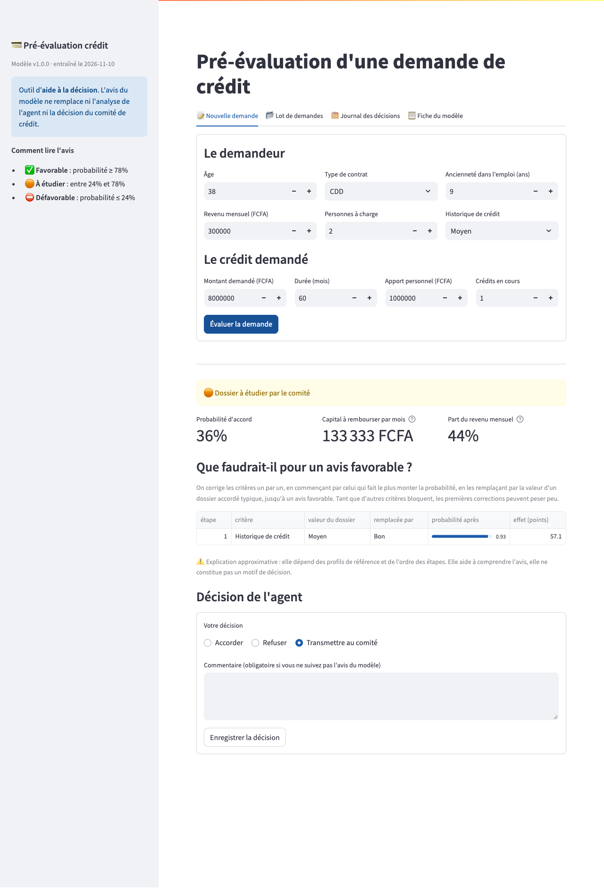
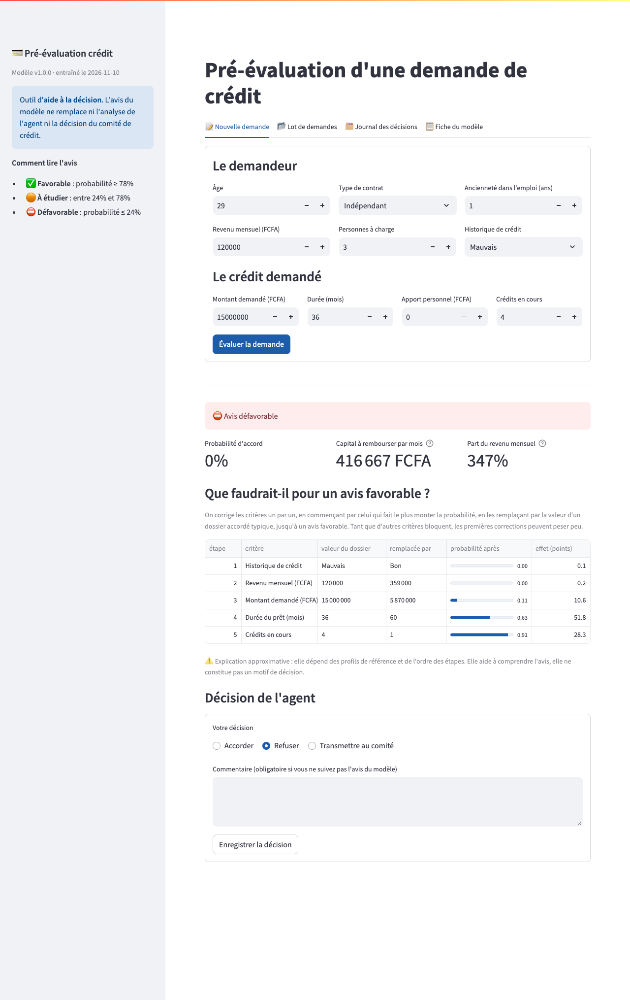
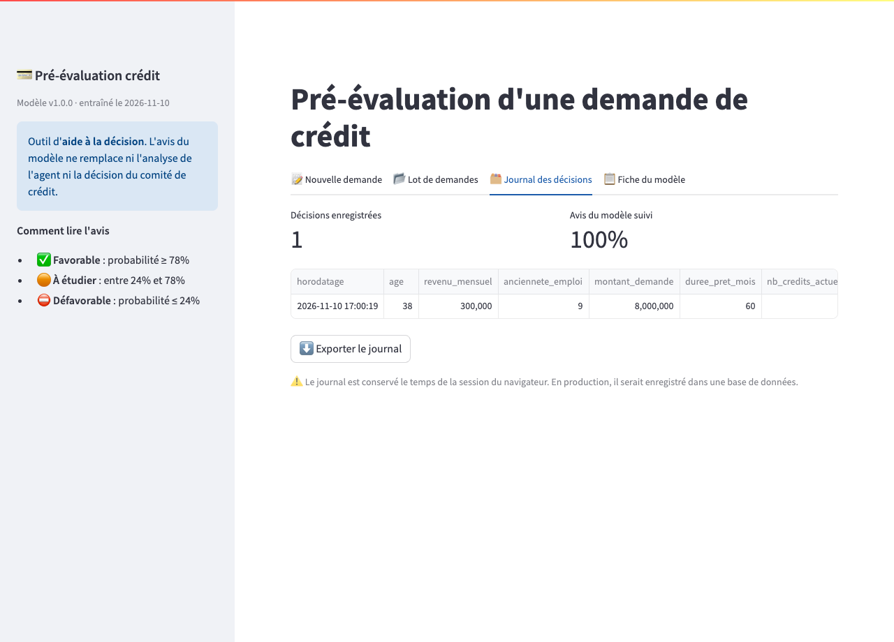
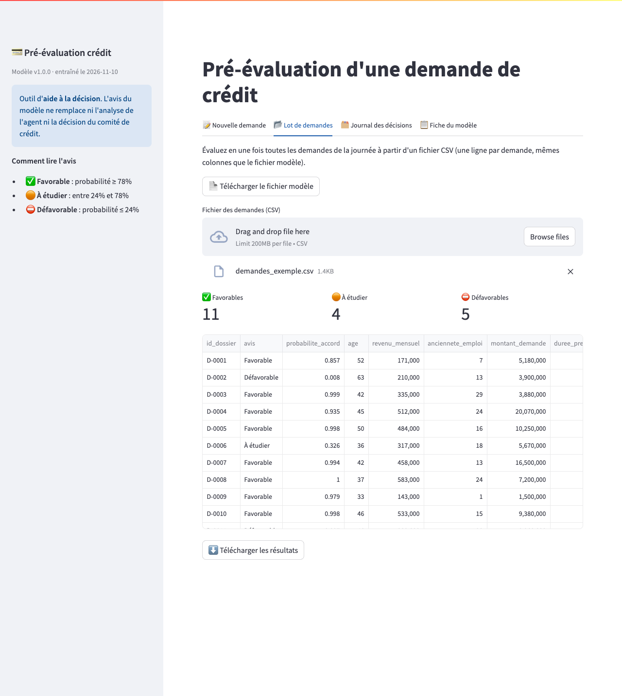
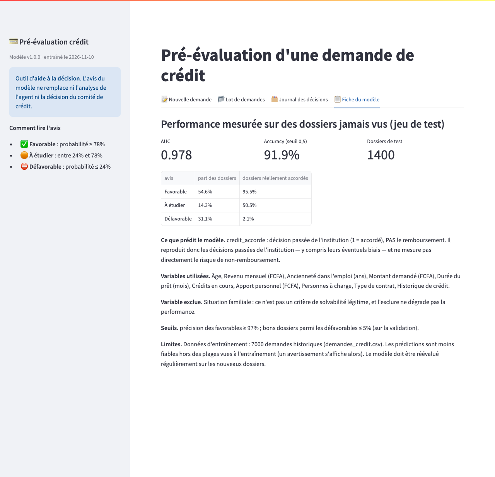

# 🚀 Model Serving with Streamlit : de A à Z, un outil utilisé par le métier — Cours Bootcamp Data Science

> **Module Data Science — Déploiement** | Prérequis (module `04-machine-learning`) : cours "Train/Test Split" (`03-...md`), "Métriques d'évaluation" (`04-...md`), "Nettoyage & Feature Scaling" (`05-...md`), TP2 Crédit

---

## Table des matières

### Partie I — Du notebook à l'outil métier
1. [Un modèle dans un notebook ne sert à personne](#1-un-modèle-dans-un-notebook-ne-sert-à-personne)
2. [Le cas d'usage : la pré-évaluation des demandes de crédit](#2-le-cas-dusage--la-pré-évaluation-des-demandes-de-crédit)
3. [Le cycle complet, de A à Z](#3-le-cycle-complet-de-a-à-z)

### Partie II — Streamlit en bref
4. [Qu'est-ce que Streamlit ?](#4-quest-ce-que-streamlit-)
5. [🧩 Le modèle d'exécution : tout le script, à chaque clic](#5--le-modèle-dexécution--tout-le-script-à-chaque-clic)
6. [Les briques essentielles](#6-les-briques-essentielles)
7. [Mémoire et performance : `session_state`, formulaires et cache](#7-mémoire-et-performance--session_state-formulaires-et-cache)

### Partie III — Construire l'application, étape par étape
8. [Étape 1 — Cadrer avec le métier](#8-étape-1--cadrer-avec-le-métier)
9. [Étape 2 — Entraîner, évaluer et enregistrer le modèle](#9-étape-2--entraîner-évaluer-et-enregistrer-le-modèle)
10. [Étape 3 — Séparer la logique métier de l'interface](#10-étape-3--séparer-la-logique-métier-de-linterface)
11. [Étape 4 — Le formulaire de saisie et la validation](#11-étape-4--le-formulaire-de-saisie-et-la-validation)
12. [Étape 5 — L'avis, les indicateurs et l'explication](#12-étape-5--lavis-les-indicateurs-et-lexplication)
13. [Étape 6 — La décision de l'agent et le journal](#13-étape-6--la-décision-de-lagent-et-le-journal)
14. [Étape 7 — Le traitement par lot](#14-étape-7--le-traitement-par-lot)
15. [Étape 8 — La fiche du modèle](#15-étape-8--la-fiche-du-modèle)

### Partie IV — Fiabiliser, déployer, faire vivre
16. [Tester l'application](#16-tester-lapplication)
17. [Configurer et organiser le projet](#17-configurer-et-organiser-le-projet)
18. [Déployer](#18-déployer)
19. [🧩 En production : surveiller, protéger, faire évoluer](#19--en-production--surveiller-protéger-faire-évoluer)
20. [🧩 Streamlit, Gradio, FastAPI : que choisir ?](#20--streamlit-gradio-fastapi--que-choisir-)

### Partie V — Synthèse
21. [Conclusion](#21-conclusion)
22. [✅ Point de contrôle — Model Serving with Streamlit](#22--point-de-contrôle--model-serving-with-streamlit)

> 🧩 = notion ajoutée parce qu'elle est indispensable pour mettre un modèle en service.

> 📁 **Le projet complet** se trouve dans [`06-deploiement/projet-scoring-credit/`](../projet-scoring-credit/). Tous les extraits de code de ce cours en sont tirés **tels quels**, et toutes les captures d'écran montrent l'application réelle, en fonctionnement. Versions utilisées : Streamlit 1.41.1, scikit-learn 1.9.1, Python 3.13.

---

# PARTIE I — DU NOTEBOOK À L'OUTIL MÉTIER

## 1. Un modèle dans un notebook ne sert à personne

### 📖 Le constat

Dans le TP2, vous avez construit un modèle qui prédit si une demande de crédit sera accordée. Il atteint une très bonne performance… **dans votre notebook**. Or l'agent de crédit qui reçoit un client à 9 h du matin n'ouvrira jamais Jupyter. Tant que le modèle reste dans un notebook, il n'a **aucune valeur** pour l'entreprise.

Le **model serving** (mise en service d'un modèle) désigne tout ce qu'il faut faire pour que les prédictions d'un modèle soient **utilisées** par des personnes ou des systèmes, de façon **fiable**, **sûre** et **durable**.

### 1.1 Trois façons de servir un modèle

| Mode | Principe | Exemple | Outils typiques |
|------|----------|---------|-----------------|
| **Par lot** (*batch*) | on prédit pour un fichier entier, à intervalles réguliers | chaque soir, évaluer toutes les demandes du jour | script planifié, Airflow |
| **API** (en ligne) | un programme envoie une requête, reçoit une prédiction | l'application mobile de la banque appelle le modèle | FastAPI, Flask |
| **Application web** | une **personne** saisit des informations et lit le résultat | l'agent remplit un formulaire pendant l'entretien | **Streamlit**, Gradio, Dash |

Ce cours construit une **application web** avec Streamlit, qui propose **aussi** un mode par lot (onglet « Lot de demandes »).

> 💡 **Analogie** : entraîner un modèle, c'est mettre au point une recette. Le servir, c'est ouvrir le restaurant : une salle, un service, une carte claire, de l'hygiène, et un cuisinier qui sait quoi faire quand un client est allergique. La recette ne représente qu'une petite partie du travail.

---

## 2. Le cas d'usage : la pré-évaluation des demandes de crédit

### 📖 Le contexte métier

Une institution de **microfinance** en Afrique de l'Ouest reçoit chaque jour des dizaines de demandes de crédit (montants en FCFA). Aujourd'hui, chaque dossier est examiné à la main : c'est long, et deux agents peuvent juger différemment deux dossiers semblables. La direction veut un outil d'**aide à la décision**.

### 2.1 Les utilisateurs et leurs besoins

| Utilisateur | Ce qu'il fait | Ce dont il a besoin |
|-------------|---------------|---------------------|
| **Aïcha, agente de crédit** | reçoit les clients en agence | pré-évaluer un dossier **pendant l'entretien**, comprendre l'avis, garder la décision finale |
| **Le comité de crédit** | tranche les dossiers difficiles | recevoir les seuls dossiers **vraiment incertains**, avec les raisons |
| **Le service risque** | pilote la politique de crédit | évaluer **un lot** de demandes, connaître la **fiabilité** du modèle, suivre son usage |

*(Aïcha est une utilisatrice fictive, imaginée pour le cours.)*

### 2.2 Les « user stories »

Une **user story** décrit un besoin du point de vue de l'utilisateur. Chacune deviendra une fonctionnalité de l'application :

1. *En tant qu'agente, je veux saisir un dossier et obtenir un avis en quelques secondes, pour orienter l'entretien.*
2. *En tant qu'agente, je veux savoir **pourquoi** le modèle donne cet avis, pour l'expliquer au client.*
3. *En tant qu'agente, je veux enregistrer **ma** décision, et la justifier si je ne suis pas l'avis.*
4. *En tant que membre du comité, je veux que seuls les dossiers incertains me parviennent.*
5. *En tant que responsable risque, je veux évaluer un fichier de demandes et télécharger les résultats.*
6. *En tant que responsable risque, je veux connaître la performance et les limites du modèle.*

### 2.3 Les règles non négociables

| Règle | Pourquoi |
|-------|----------|
| Le modèle **conseille**, l'humain **décide** | une décision de crédit engage l'institution et le client |
| Toute décision contraire à l'avis est **justifiée** | traçabilité, apprentissage, contrôle |
| Aucune variable **discriminatoire** | la situation familiale ne doit pas peser sur l'accès au crédit |
| Les limites du modèle sont **affichées** | un outil qui cache ses faiblesses finit par tromper ses utilisateurs |

---

## 3. Le cycle complet, de A à Z



*Figure 1 — Les huit étapes du projet. Les étapes ② et ③ ont été vues dans les modules précédents ; ce cours les reprend rapidement et se concentre sur ①, puis ④ à ⑧.*

> 🔑 **Le serving n'est pas la dernière étape d'un projet : c'est le début de la vie du modèle.** Une fois en service, il faut le surveiller, le corriger et le réentraîner.

---

# PARTIE II — STREAMLIT EN BREF

## 4. Qu'est-ce que Streamlit ?

**Streamlit** est une bibliothèque Python qui transforme un **script Python** en **application web**, sans HTML, CSS ni JavaScript. On écrit des appels comme `st.title(...)`, `st.number_input(...)` ou `st.dataframe(...)`, et Streamlit construit la page.

```bash
pip install streamlit
streamlit run app.py          # ouvre l'application sur http://localhost:8501
```

### 4.1 Une première application

```python
import streamlit as st

st.title("Calcul de mensualité")
montant = st.number_input("Montant emprunté (FCFA)", min_value=0, value=1_000_000, step=50_000)
duree = st.number_input("Durée (mois)", min_value=1, value=12)
mensualite = f"{montant / duree:,.0f}".replace(",", " ")      # 83 333 plutôt que 83,333
st.metric("Capital à rembourser par mois (hors intérêts)", f"{mensualite} FCFA")
```

Enregistrez ces lignes dans `app.py`, lancez `streamlit run app.py` : vous avez une page web avec deux champs et un résultat qui se met à jour dès que vous changez une valeur.

---

## 5. 🧩 Le modèle d'exécution : tout le script, à chaque clic

C'est **la** notion à comprendre avant tout le reste, et la source de la plupart des bugs des débutants.



*Figure 2 — À chaque interaction (un clic, une saisie), Streamlit **réexécute tout le script**, de la première à la dernière ligne, et redessine la page.*

Conséquences directes :

1. **Les variables ordinaires sont oubliées** à chaque interaction. Un compteur écrit `compteur = 0` puis `compteur += 1` vaudra toujours 1.
2. **Un calcul coûteux placé dans le script est refait à chaque clic** : charger un modèle de 400 Ko, lire un gros fichier…
3. **Les résultats affichés sous `if st.button(...)` disparaissent** au clic suivant, car le bouton ne vaut `True` que pendant **une** exécution.

Streamlit fournit trois outils pour s'en sortir : `st.session_state` (la mémoire), `st.form` (regrouper des saisies) et le **cache**. C'est l'objet de la section 7.

---

## 6. Les briques essentielles

| Besoin | Fonction | Utilisé dans le projet pour |
|--------|----------|------------------------------|
| Titre, texte | `st.title`, `st.subheader`, `st.markdown`, `st.caption` | les titres, les explications |
| Saisir un nombre | `st.number_input` | âge, revenu, montant… |
| Choisir dans une liste | `st.selectbox`, `st.radio` | type de contrat, décision de l'agent |
| Saisir du texte | `st.text_area` | le commentaire de l'agent |
| Bouton | `st.button`, `st.form_submit_button` | « Évaluer la demande » |
| Messages | `st.success`, `st.warning`, `st.error`, `st.info` | l'avis, les alertes de saisie |
| Indicateur chiffré | `st.metric` | probabilité, capital mensuel |
| Tableau | `st.dataframe` (+ `column_config`) | explication, lot, journal |
| Mise en page | `st.columns`, `st.tabs`, `st.sidebar`, `st.divider` | colonnes du formulaire, 4 onglets |
| Fichiers | `st.file_uploader`, `st.download_button` | importer un lot, exporter les résultats |

---

## 7. Mémoire et performance : `session_state`, formulaires et cache

### 7.1 `st.session_state` : la mémoire de l'utilisateur

`st.session_state` se comporte comme un dictionnaire qui **survit** aux réexécutions. Chaque utilisateur (chaque onglet de navigateur) a **le sien**.

```python
import streamlit as st

if "nb_dossiers" not in st.session_state:      # initialisation, une seule fois par session
    st.session_state.nb_dossiers = 0

if st.button("Dossier traité"):
    st.session_state.nb_dossiers += 1

st.write(f"Dossiers traités dans cette session : {st.session_state.nb_dossiers}")
```

### 7.2 `st.form` : valider plusieurs saisies d'un coup

Sans formulaire, chaque modification d'un champ relance le script, donc le calcul. Avec `st.form`, les saisies sont **regroupées** et le script ne repart qu'au clic sur le bouton d'envoi : c'est ce qu'on veut pour un dossier de crédit de 10 champs.

### 7.3 Le cache : ne calculer qu'une fois

| Décorateur | Pour quoi | Comportement |
|------------|-----------|--------------|
| `@st.cache_resource` | un **objet** à partager : modèle, connexion à une base | créé **une seule fois** pour tous les utilisateurs |
| `@st.cache_data` | une **donnée** calculée : fichier lu, résultat de requête | résultat mémorisé selon les arguments, renvoyé en copie |

Dans le projet, le modèle est chargé une seule fois, quel que soit le nombre d'agents connectés :

```python
# --------------------------------------------------------------------------- chargement (une seule fois)
@st.cache_resource
def charger_modele():
    return scoring.charger()


@st.cache_data
def fichier_exemple():
    return (ICI / "donnees" / "demandes_exemple.csv").read_bytes()


modele, fiche = charger_modele()
```

> ⚠️ **Le cache se trompe s'il ne voit pas le changement.** Pendant la réalisation de ce projet, le serveur a continué d'exécuter l'**ancienne** version de `app.py` après une correction : la page affichait encore l'ancien message. Si l'application ne reflète pas vos modifications, **redémarrez le serveur** (`Ctrl + C`, puis `streamlit run app.py`). Et si vous réentraînez le modèle pendant que l'application tourne, le cache garde l'ancien modèle tant que le serveur n'est pas relancé.

---

# PARTIE III — CONSTRUIRE L'APPLICATION, ÉTAPE PAR ÉTAPE

## 8. Étape 1 — Cadrer avec le métier

Avant d'écrire une ligne de Streamlit, on fixe avec le métier ce que l'outil **décide**, ce qu'il **affiche** et ce qu'il **refuse**.

### 8.1 Que prédit vraiment le modèle ?

La cible `credit_accorde` est la **décision passée** de l'institution, pas le fait que le client a remboursé. Le modèle apprend donc à **reproduire les décisions des agents** — y compris leurs éventuels biais. Il est utile pour gagner du temps et harmoniser les décisions ; il ne mesure **pas** directement le risque de non-remboursement. Pour cela, il faudrait des données de remboursement.

> 🔑 **Toujours demander : « que représente exactement la cible ? »** C'est la question qui évite les plus graves malentendus entre data scientists et métier.

### 8.2 Trois zones de décision au lieu d'un seuil

Un seuil unique à 0,5 forcerait le modèle à trancher même quand il hésite. On définit plutôt **trois zones** :

```
probabilité  0 ─────────── seuil bas ─────────────── seuil haut ─────────── 1
             ⛔ DÉFAVORABLE      🟠 À ÉTUDIER (comité)       ✅ FAVORABLE
```

Les seuils sont fixés avec le service risque, à partir de **règles métier** :
- parmi les avis **favorables**, au moins **97 %** de dossiers réellement accordés ;
- parmi les avis **défavorables**, au plus **5 %** de dossiers réellement accordés.

### 8.3 Une variable exclue

La **situation familiale** n'est pas un critère de solvabilité légitime. On l'a vérifié avant de l'exclure : l'AUC en validation croisée est **identique** avec ou sans elle (0,979), donc l'exclure ne coûte rien.

> ⚠️ **Retirer une variable ne suffit pas toujours** : d'autres variables peuvent la refléter indirectement (on parle de **variables proxy**). Par exemple, le nombre de personnes à charge est lié à la situation familiale. Il faut surveiller les résultats par groupe, pas seulement les variables utilisées.

---

## 9. Étape 2 — Entraîner, évaluer et enregistrer le modèle

Le script [`entrainer_modele.py`](../projet-scoring-credit/entrainer_modele.py) fait tout le travail « data science » et produit deux fichiers que l'application chargera.

### 9.1 Le découpage en trois jeux

```
7 000 demandes ──► 60 % ENTRAÎNEMENT (4 200) : apprendre
                   20 % VALIDATION   (1 400) : choisir les seuils
                   20 % TEST         (1 400) : mesurer la performance, UNE seule fois
```

Les seuils sont des **réglages** : les choisir sur le test reviendrait à tricher (cours *Train/Test Split*). On les choisit sur la validation.

### 9.2 Le modèle

Un **Gradient Boosting** (`HistGradientBoostingClassifier`) dans un `Pipeline` avec imputation des valeurs manquantes et encodage one-hot. Il a été préféré à la régression logistique du TP2 après comparaison en validation croisée : AUC 0,979 contre 0,956.

### 9.3 Le choix des seuils, traduit en code

```python
def choisir_seuils(p, y):
    """Seuil haut : le plus bas tel que la précision des favorables atteigne l'objectif.
    Seuil bas : le plus haut tel que la part de bons dossiers parmi les défavorables reste sous le plafond."""
    grille = np.round(np.arange(0.50, 1.00, 0.01), 2)
    haut = next(float(s) for s in grille if y[p >= s].mean() >= PRECISION_MIN_FAVORABLE)
    grille_bas = np.round(np.arange(0.50, 0.00, -0.01), 2)
    bas = next(float(s) for s in grille_bas if y[p <= s].mean() <= TAUX_MAX_BONS_DEFAVORABLE)
    return bas, haut
```

### 9.4 Le résultat

```
Modèle 1.0.0 enregistré dans .../projet-scoring-credit/modele/
Test : AUC 0.978 | accuracy (seuil 0,5) 0.919 | Brier 0.0582 | écart de calibration max 0.121
Seuils : défavorable si p ≤ 0.24 · favorable si p ≥ 0.78
  Favorable     54.6% des dossiers | dont accordés en réalité : 95.5%
  À étudier     14.3% des dossiers | dont accordés en réalité : 50.5%
  Défavorable   31.1% des dossiers | dont accordés en réalité : 2.1%
```

Lecture métier :
- **85,7 % des dossiers** (54,6 + 31,1) reçoivent un avis net ; le comité ne voit plus que **14,3 %** des dossiers, ceux où le modèle hésite vraiment (50,5 % d'accordés : un vrai pile ou face).
- **Les seuils choisis sur la validation ne tiennent pas exactement sur le test** : 95,5 % d'accordés parmi les favorables au lieu des 97 % visés. Un seuil réglé sur un échantillon ne garantit pas le même résultat ailleurs. Il faudra **le revérifier en production**.
- **La calibration est imparfaite** : dans certaines tranches de probabilité, l'écart entre la probabilité annoncée et la fréquence observée atteint 12 points. C'est pourquoi l'application met en avant **l'avis par zone** plutôt que la probabilité brute.

### 9.5 Enregistrer le modèle… et sa fiche

Le pipeline complet (prétraitement + modèle) est enregistré avec `joblib`. À côté, un fichier `fiche_modele.json` regroupe ce que l'application doit savoir : version, date, métriques, seuils, catégories autorisées, plages de valeurs vues à l'entraînement, profils de référence pour les explications.

> 🔑 **Le modèle seul ne suffit pas.** Sans la fiche, l'application ne connaîtrait ni les seuils, ni les plages valides, ni la version à afficher. Enregistrer les deux ensemble garantit qu'ils restent cohérents.

> ⚠️ **Sécurité** : `joblib.load` (comme `pickle`) peut **exécuter du code** contenu dans le fichier. Ne chargez **jamais** un fichier `.joblib` d'origine inconnue. Et figez la version de scikit-learn : un modèle enregistré avec une version n'est garanti qu'avec cette version.

---

## 10. Étape 3 — Séparer la logique métier de l'interface



*Figure 3 — Qui fait quoi dans le projet.*

Toute la logique métier vit dans [`scoring.py`](../projet-scoring-credit/scoring.py), **sans aucun appel à Streamlit** : validation de la saisie, calcul de la probabilité, avis, explication, évaluation d'un lot. `app.py` ne fait qu'afficher.

| Avantage | Concrètement |
|----------|--------------|
| **Testable** | on teste `scoring.py` avec pytest, sans lancer d'interface |
| **Réutilisable** | demain, une API FastAPI pourra appeler les **mêmes** fonctions |
| **Lisible** | `app.py` reste centré sur l'expérience de l'utilisateur |

L'avis découle directement des seuils de la fiche :

```python
def decision(p, fiche):
    s = fiche["seuils"]
    if p >= s["haut"]:
        return "Favorable"
    if p <= s["bas"]:
        return "Défavorable"
    return "À étudier"
```

---

## 11. Étape 4 — Le formulaire de saisie et la validation



*Figure 4 — L'écran d'accueil : la barre latérale rappelle que l'outil est une aide à la décision et explique les trois avis.*

### 11.1 Le formulaire

```python
with st.form("demande"):
    st.subheader("Le demandeur")
    c1, c2, c3 = st.columns(3)
    age = c1.number_input("Âge", min_value=18, max_value=80, value=35, key="age")
    type_contrat = c2.selectbox("Type de contrat",
                                ordonner(fiche["categories"]["type_contrat"],
                                         ["CDI", "Fonctionnaire", "CDD", "Indépendant"]), key="type_contrat")
    anciennete = c3.number_input("Ancienneté dans l'emploi (ans)", 0, 50, 5, key="anciennete_emploi")
    c1, c2, c3 = st.columns(3)
    revenu = c1.number_input("Revenu mensuel (FCFA)", 0, 10_000_000, 300_000, step=10_000, key="revenu_mensuel")
    personnes = c2.number_input("Personnes à charge", 0, 15, 1, key="nb_personnes_charge")
    historique = c3.selectbox("Historique de crédit",
                              ordonner(fiche["categories"]["historique_credit"], ["Bon", "Moyen", "Mauvais"]),
                              key="historique_credit")

    st.subheader("Le crédit demandé")
    c1, c2, c3, c4 = st.columns(4)
    montant = c1.number_input("Montant demandé (FCFA)", 0, 100_000_000, 3_000_000, step=100_000,
                              key="montant_demande")
    duree = c2.number_input("Durée (mois)", 1, 240, 36, key="duree_pret_mois")
    apport = c3.number_input("Apport personnel (FCFA)", 0, 100_000_000, 500_000, step=50_000,
                             key="apport_personnel")
    credits = c4.number_input("Crédits en cours", 0, 20, 0, key="nb_credits_actuels")
    envoyer = st.form_submit_button("Évaluer la demande", type="primary")
```

Points de conception :
- `st.form` : le calcul ne part qu'au clic sur **Évaluer la demande**, pas à chaque champ modifié ;
- `min_value` / `max_value` : l'interface empêche déjà les saisies absurdes (un âge de 12 ans) ;
- chaque widget a une **clé** (`key=...`) : c'est ce qui permet de le retrouver dans les tests ;
- les listes viennent de la **fiche du modèle** : impossible de proposer une catégorie que le modèle ne connaît pas.

### 11.2 Valider avant de prédire

Un modèle répond **toujours**, même à une saisie absurde. La validation distingue deux niveaux :

| Niveau | Effet | Exemples |
|--------|-------|----------|
| **Erreur** | bloque l'évaluation | champ manquant, demandeur mineur, revenu nul, catégorie inconnue |
| **Avertissement** | évaluation faite, mais signalée comme moins fiable | valeur hors de la plage vue à l'entraînement, ancienneté incohérente avec l'âge |

```python
def valider(demande, fiche):
    """Retourne (erreurs, avertissements). Une erreur bloque l'évaluation, un avertissement non."""
    erreurs, avertissements = [], []
    manquantes = [LIBELLES[c] for c in colonnes(fiche) if demande.get(c) is None or demande.get(c) == ""]
    if manquantes:
        erreurs.append("Champs manquants : " + ", ".join(manquantes))
        return erreurs, avertissements

    for c in fiche["variables"]["categorielles"]:
        if demande[c] not in fiche["categories"][c]:
            erreurs.append(f"{LIBELLES[c]} : valeur inconnue « {demande[c]} »")
    if demande["age"] < 18:
        erreurs.append("Le demandeur doit être majeur (18 ans au moins).")
    if demande["revenu_mensuel"] <= 0:
        erreurs.append("Le revenu mensuel doit être positif.")
    if demande["duree_pret_mois"] <= 0:
        erreurs.append("La durée du prêt doit être positive.")
    if erreurs:
        return erreurs, avertissements

    for c, (mini, maxi) in fiche["bornes"].items():
        if not mini <= demande[c] <= maxi:
            avertissements.append(f"{LIBELLES[c]} = {nombre(demande[c])} est hors de la plage vue à l'entraînement "
                                  f"({nombre(mini)} – {nombre(maxi)}) : la prédiction est moins fiable.")
    if demande["anciennete_emploi"] > demande["age"] - 16:
        avertissements.append("L'ancienneté dans l'emploi semble incohérente avec l'âge : vérifiez la saisie.")
    return erreurs, avertissements
```

> 💡 **Pourquoi un avertissement pour l'ancienneté ?** Dans le jeu de données, 1 548 demandes (22 %) ont une ancienneté supérieure à « âge − 16 ». C'est le signe d'un jeu **synthétique** imparfait. En production, une telle incohérence est presque toujours une **erreur de saisie** : l'application la signale.

---

## 12. Étape 5 — L'avis, les indicateurs et l'explication

### 12.1 Calculer une fois, afficher à chaque exécution

Au clic, on calcule tout et on **range le résultat dans `st.session_state`**. Ainsi, l'avis reste affiché quand l'agent interagit ensuite avec la suite de la page (section 5, conséquence 3) :

```python
if envoyer:
    demande = {"age": age, "revenu_mensuel": revenu, "anciennete_emploi": anciennete,
               "montant_demande": montant, "duree_pret_mois": duree, "nb_credits_actuels": credits,
               "apport_personnel": apport, "nb_personnes_charge": personnes,
               "type_contrat": type_contrat, "historique_credit": historique}
    erreurs, avertissements = scoring.valider(demande, fiche)
    evaluation = {"demande": demande, "erreurs": erreurs, "avertissements": avertissements}
    if not erreurs:
        p = scoring.probabilite(modele, demande, fiche)
        evaluation.update(p=p, avis=scoring.decision(p, fiche),
                          indicateurs=scoring.indicateurs(demande),
                          explication=scoring.expliquer(modele, demande, fiche))
    st.session_state.n_evaluation += 1
    evaluation["numero"] = st.session_state.n_evaluation
    st.session_state.evaluation = evaluation        # survit aux réexécutions du script
```

### 12.2 Un dossier « à étudier »



*Figure 5 — Un dossier à 36 % : ni assez sûr pour un avis favorable, ni assez faible pour un avis défavorable. Il part au comité.*

L'écran donne à l'agente trois niveaux de lecture :
1. **L'avis**, en couleur, avec une icône et un libellé : il n'est jamais porté par la couleur seule ;
2. **Les indicateurs** : probabilité, capital à rembourser par mois (hors intérêts) et sa part dans le revenu. Ici, 133 333 FCFA, soit 44 % du revenu : un premier signal concret ;
3. **L'explication**.

### 12.3 🧩 Expliquer un avis : le « chemin vers un avis favorable »

La première idée qui vient : pour chaque critère, le remplacer par celui d'un dossier accordé typique, et mesurer l'effet. Testée sur un dossier très mauvais, **elle échoue** : chaque critère, corrigé **seul**, ne change presque rien (+0,1 point), car les autres critères suffisent à faire refuser le dossier. L'agente verrait « aucun critère ne compte », ce qui est faux.

On procède donc **pas à pas** : à chaque étape, on corrige le critère qui fait **le plus** monter la probabilité, jusqu'à atteindre un avis favorable. Pour un dossier favorable, on fait l'inverse pour trouver ses **atouts** : on dégrade, un à un, ses critères vers ceux d'un dossier refusé typique.

Sur la figure 5, l'explication tient en **une étape** : avec un historique « Bon » au lieu de « Moyen », la probabilité passerait de 36 % à 93 %. C'est une information directement utilisable en entretien.



*Figure 6 — Un dossier défavorable. Le chemin compte cinq étapes ; les deux premières (historique, revenu) pèsent peu tant que le montant, la durée et les crédits en cours bloquent encore. Le capital mensuel représente 347 % du revenu : le dossier n'est pas finançable en l'état.*

> ⚠️ **Une explication est une aide, pas une vérité.** Ce chemin dépend des profils de référence choisis et de l'ordre des étapes ; l'application le dit en toutes lettres. Des méthodes plus rigoureuses existent (valeurs de Shapley, bibliothèque SHAP), mais aucune ne transforme une explication en motif de décision.

---

## 13. Étape 6 — La décision de l'agent et le journal

### 13.1 L'humain décide, et le justifie

Le formulaire de décision propose par défaut la décision qui correspond à l'avis. L'agente peut s'en écarter, à condition d'écrire un **commentaire**. Une fois la décision enregistrée, le formulaire laisse place à une confirmation, ce qui empêche les doubles enregistrements.

### 13.2 🧩 Un vrai bug, et sa leçon

La première version utilisait des clés fixes : `key="choix"` et `key="commentaire"`. Les tests automatiques passaient. Mais en utilisant l'application dans un vrai navigateur, on a constaté que **le commentaire saisi pour un client réapparaissait dans le dossier du client suivant** : Streamlit conserve la valeur d'un widget tant que sa clé ne change pas. Un agent pressé aurait pu enregistrer le commentaire d'un autre client.

La correction : une clé **propre à chaque dossier évalué**, grâce à un numéro d'évaluation.

```python
if ev.get("enregistree"):
    st.success(f"Décision « {ev['enregistree']} » enregistrée dans le journal. "
               "Saisissez une nouvelle demande pour continuer.")
else:
    n = ev["numero"]                    # clés propres à CE dossier : rien ne passe au dossier suivant
    with st.form(f"decision_{n}"):
        attendue = DECISION_ATTENDUE[ev["avis"]]
        options = ["Accorder", "Refuser", "Transmettre au comité"]
        choix = st.radio("Votre décision", options, index=options.index(attendue), horizontal=True,
                         key=f"choix_{n}")
        commentaire = st.text_area("Commentaire (obligatoire si vous ne suivez pas l'avis du modèle)",
                                   key=f"commentaire_{n}")
        enregistrer = st.form_submit_button("Enregistrer la décision")
    if enregistrer:
        if choix != attendue and not commentaire.strip():
            st.error("Vous ne suivez pas l'avis du modèle : expliquez pourquoi dans le commentaire.")
        else:
            st.session_state.journal.append({
                "horodatage": datetime.now().strftime("%Y-%m-%d %H:%M:%S"),
                **ev["demande"], "probabilite": round(ev["p"], 3), "avis_modele": ev["avis"],
                "decision_agent": choix, "avis_suivi": choix == attendue,
                "commentaire": commentaire.strip(), "version_modele": fiche["version"]})
            ev["enregistree"] = choix
            st.rerun()                  # réaffiche la page : le formulaire laisse place à la confirmation
```

> 🔑 **Deux leçons.** (1) Dans Streamlit, **la clé d'un widget est son identité** : même clé, même valeur conservée. (2) Les tests automatiques ne remplacent pas un **essai réel**, idéalement par un futur utilisateur. Une fois le bug compris, on a écrit deux tests qui le reproduisent (section 16.1), pour qu'il ne revienne jamais.

### 13.3 Le journal des décisions



*Figure 7 — Chaque décision est horodatée, avec la version du modèle, l'avis, la décision de l'agent et le commentaire. Le taux d'avis suivi est un premier indicateur de confiance.*

> ⚠️ **Limite assumée** : ce journal vit dans `st.session_state`, il disparaît à la fermeture du navigateur. En production, il serait enregistré dans une **base de données**. L'application l'indique sous le tableau.

---

## 14. Étape 7 — Le traitement par lot



*Figure 8 — Le service risque importe les 20 demandes du fichier d'exemple : 11 favorables, 4 à étudier, 5 défavorables. Les colonnes `id_dossier`, `avis` et `probabilite_accord` sont placées en tête : c'est ce qu'on lit en premier.*

```python
def scorer_lot(modele, df, fiche):
    """Évalue un fichier de demandes. Lève ValueError si des colonnes obligatoires manquent."""
    manquantes = [c for c in colonnes(fiche) if c not in df.columns]
    if manquantes:
        raise ValueError("Colonnes manquantes dans le fichier : " + ", ".join(manquantes))
    resultat = df.copy()
    resultat["probabilite_accord"] = modele.predict_proba(df[colonnes(fiche)])[:, 1].round(3)
    resultat["avis"] = [decision(p, fiche) for p in resultat["probabilite_accord"]]
    return resultat
```

Détails qui comptent pour le métier :
- **un fichier modèle téléchargeable** : l'utilisateur sait exactement quelles colonnes fournir ;
- **un message clair** si une colonne manque, au lieu d'une erreur Python incompréhensible ;
- **l'export en `utf-8-sig`** : les accents s'affichent correctement quand le fichier est ouvert dans Excel ;
- le fichier d'exemple est tiré du **jeu de test** : ces dossiers n'ont jamais servi à l'entraînement.

> 💡 Les textes du composant d'import (« Drag and drop file here », « Browse files ») restent en anglais : Streamlit 1.41 ne permet pas de les traduire. C'est une limite à connaître avant de présenter l'outil.

---

## 15. Étape 8 — La fiche du modèle



*Figure 9 — Tout ce que le service risque doit savoir, lu directement depuis `fiche_modele.json` : performance sur des dossiers jamais vus, répartition des avis, nature de la cible, variables utilisées et exclue, règle des seuils, limites.*

> 🔑 **Un modèle mis en service doit dire ce qu'il sait faire… et ce qu'il ne sait pas faire.** Cette « fiche du modèle » (on parle en anglais de *model card*) est la première chose à montrer à un comité qui doit autoriser l'outil.

---

# PARTIE IV — FIABILISER, DÉPLOYER, FAIRE VIVRE

## 16. Tester l'application

Deux niveaux de tests, lancés par `python -m pytest tests` (**16 tests, tous passent**) :

| Fichier | Ce qu'il teste | Outil |
|---------|----------------|-------|
| `tests/test_scoring.py` | la logique métier : seuils, validation, explication, lot | pytest |
| `tests/test_app.py` | l'**application elle-même** : démarrage, formulaire, avis, décision, journal | `streamlit.testing.v1.AppTest` |

**`AppTest`** exécute `app.py` **sans navigateur**, permet de remplir les widgets, de cliquer, puis d'inspecter ce qui s'affiche. Deux petites fonctions évitent de répéter le remplissage du formulaire :

```python
def remplir(at, **valeurs):
    for cle, v in valeurs.items():
        widget = at.selectbox(key=cle) if cle in ("type_contrat", "historique_credit") else at.number_input(key=cle)
        widget.set_value(v)
    return at
```

```python
def evaluer(at):
    next(b for b in at.button if b.label == "Évaluer la demande").click()
    return at.run()
```

### 16.1 Les tests de non-régression du bug du commentaire

```python
def test_le_commentaire_ne_passe_pas_au_dossier_suivant():
    """Régression : le commentaire d'un dossier ne doit jamais réapparaître sur le suivant."""
    at = AppTest.from_file(APP, default_timeout=60).run()
    evaluer(at)
    at.text_area[0].set_value("Commentaire du premier client")
    next(b for b in at.button if b.label == "Enregistrer la décision").click()
    at.run()
    assert len(at.session_state.journal) == 1
    assert any("enregistrée dans le journal" in s.value for s in at.success)

    remplir(at, revenu_mensuel=120_000, montant_demande=15_000_000, historique_credit="Mauvais")
    evaluer(at)
    assert at.text_area[0].value == ""
```

```python
def test_un_commentaire_non_enregistre_ne_passe_pas_au_dossier_suivant():
    """Régression : même NON enregistré, un commentaire ne doit pas suivre l'agent sur le dossier suivant.
    (Ce test échoue si les widgets de décision gardent une clé fixe.)"""
    at = AppTest.from_file(APP, default_timeout=60).run()
    evaluer(at)
    at.text_area[0].set_value("Commentaire du premier client")      # saisi, mais pas enregistré
    remplir(at, revenu_mensuel=120_000, montant_demande=15_000_000, historique_credit="Mauvais")
    evaluer(at)
    assert at.text_area[0].value == ""
```

Pour vérifier que ces tests protègent vraiment, on les a lancés sur trois versions de l'application :

| Version de l'application | Commentaire enregistré | Commentaire non enregistré |
|--------------------------|------------------------|----------------------------|
| d'origine : clés fixes, formulaire toujours affiché (le bug observé) | ❌ échoue | ❌ échoue |
| clés fixes + confirmation après enregistrement | ✅ passe | ❌ échoue |
| actuelle : une clé par dossier + confirmation | ✅ passe | ✅ passe |

> 💡 **Ce que ce tableau enseigne** : un test qui passe sur la version boguée ne protège de rien. Ici, le premier test seul aurait laissé croire que la confirmation suffisait ; le second prouve qu'il faut des clés propres à chaque dossier. Vérifiez toujours qu'un test de non-régression **échoue** sur l'ancienne version.

---

## 17. Configurer et organiser le projet

### 17.1 L'arborescence

```
projet-scoring-credit/
├── app.py                 # interface Streamlit (4 onglets)
├── scoring.py             # logique métier pure
├── entrainer_modele.py    # entraînement, seuils, fiche du modèle
├── modele/                # modele_credit.joblib + fiche_modele.json
├── donnees/               # demandes_exemple.csv (jeu de test)
├── tests/                 # test_scoring.py + test_app.py
├── .streamlit/config.toml # configuration de l'application
├── requirements.txt       # dépendances, versions figées
└── README.md              # démarrage rapide
```

### 17.2 La configuration : `.streamlit/config.toml`

```toml
# Configuration de l'application (lue au démarrage de « streamlit run »)
[theme]
base = "light"               # thème clair, quel que soit le réglage du navigateur
primaryColor = "#1c5cab"     # couleur des boutons principaux

[client]
toolbarMode = "minimal"      # masque le menu développeur (bouton « Deploy ») pour les utilisateurs métier

[browser]
gatherUsageStats = false     # pas d'envoi de statistiques d'usage à Streamlit
```

Le thème clair rend l'application identique sur tous les postes, et le mode `minimal` masque le menu du développeur (bouton « Deploy ») aux utilisateurs métier.

### 17.3 Les dépendances : `requirements.txt`

```text
# Versions figées : le modèle (modele/modele_credit.joblib) a été enregistré avec scikit-learn 1.9.1.
# Un pickle scikit-learn n'est garanti qu'avec la version qui l'a créé.
streamlit==1.41.1
scikit-learn==1.9.1
pandas==2.2.3
numpy==2.3.5
joblib==1.6.0
# Tests (inutiles en production)
pytest==8.3.4
```

> 🔑 **Figer les versions** (`==`) garantit que l'application tournera sur le serveur exactement comme sur votre machine — et, surtout, que le modèle enregistré se chargera.

---

## 18. Déployer

> ⚠️ Les étapes de cette section décrivent le déploiement ; elles n'ont pas été exécutées pour préparer le cours, car elles publieraient l'application.

### 18.1 Streamlit Community Cloud (pour une démonstration)

Le plus simple pour montrer un prototype :

1. Poussez le projet sur **GitHub**, avec `requirements.txt` dans le **même dossier** que `app.py`.
2. Connectez-vous à Streamlit Community Cloud avec votre compte GitHub.
3. Créez une application : choisissez le dépôt, la branche, et le chemin du fichier principal, ici `06-deploiement/projet-scoring-credit/app.py`.
4. Choisissez la version de Python dans les paramètres avancés, puis lancez le déploiement.

> ⚠️ **Pas pour des données réelles de clients.** Une application publiée sur un service public peut être accessible à quiconque connaît son adresse. Pour de vrais dossiers, hébergez-la **en interne**, derrière une authentification.

### 18.2 En interne (pour la production)

- Un serveur de l'institution lance `streamlit run app.py --server.port 8501`, derrière un serveur web (*reverse proxy*) qui gère le HTTPS et l'accès.
- **Authentification** : les versions récentes de Streamlit proposent `st.login` (connexion via un fournisseur d'identité OpenID Connect) ; sinon, l'accès est contrôlé par le *reverse proxy*.
- **Secrets** (mot de passe de base de données…) : dans `.streamlit/secrets.toml`, lus avec `st.secrets`, et **jamais** commités dans Git.
- **Conteneur Docker** : il empaquette Python, les dépendances et l'application, pour qu'elle tourne à l'identique sur n'importe quel serveur.

---

## 19. 🧩 En production : surveiller, protéger, faire évoluer

### 19.1 Surveiller

| Indicateur | Où le lire | Signal d'alerte |
|------------|------------|-----------------|
| **Répartition des avis** | journal / lots | s'écarte nettement de la fiche (54,6 % / 14,3 % / 31,1 %) : les dossiers ont changé (**dérive des données**) |
| **Taux d'avis suivi** | journal | baisse durable : les agents ne font plus confiance au modèle — pourquoi ? |
| **Commentaires** | journal | des motifs récurrents révèlent ce que le modèle ignore |
| **Saisies hors plage** | avertissements | le profil des clients sort de ce que le modèle a appris |
| **Issue réelle des crédits** | système de gestion des prêts | permet enfin de mesurer le risque réel, et de revalider les seuils |

### 19.2 Faire évoluer

- **Versionner** : chaque modèle a un numéro (`1.0.0`), enregistré dans la fiche **et** dans chaque ligne du journal. On sait toujours quel modèle a produit quel avis.
- **Réentraîner** quand les données dérivent, puis **réévaluer** sur un nouveau jeu de test et **revalider les seuils** avec le service risque avant de remplacer l'ancien modèle.
- **Communiquer** chaque changement aux utilisateurs.

### 19.3 Protéger

- **Données personnelles** : revenus, âge et historique de crédit sont des données sensibles. Limitez qui y accède, ne les copiez pas inutilement, et respectez la réglementation : en Côte d'Ivoire, la loi n° 2013-450 du 19 juin 2013 relative à la protection des données à caractère personnel.
- **Équité** : comparez régulièrement les taux d'avis favorables entre groupes (par exemple par type de contrat ou par tranche d'âge) pour détecter un traitement injuste, y compris par des variables proxy.
- **Sécurité** : ne chargez que vos propres fichiers `.joblib`, gardez les secrets hors de Git, et mettez à jour les dépendances.

---

## 20. 🧩 Streamlit, Gradio, FastAPI : que choisir ?

| Outil | Idéal pour | Moins adapté pour |
|-------|-----------|-------------------|
| **Streamlit** | applications de données pour des utilisateurs métier : formulaires, tableaux, graphiques, plusieurs onglets | applications à très fort trafic, interfaces très personnalisées |
| **Gradio** | démonstration rapide d'un modèle (une entrée → une sortie), surtout image, texte, audio | outils métier riches avec plusieurs écrans |
| **FastAPI** | **API** appelée par d'autres programmes (application mobile, site web, autre service) | utilisateurs humains (pas d'interface) |
| **Dash** | tableaux de bord analytiques interactifs | prototypes très rapides |

> 💡 Grâce à la séparation `scoring.py` / `app.py`, passer de Streamlit à une API FastAPI ne demanderait que d'écrire une nouvelle « façade » : les règles métier restent les mêmes.

---

# PARTIE V — SYNTHÈSE

## 21. Conclusion

### 🎓 Ce qu'il faut absolument retenir

1. **Un modèle n'a de valeur que s'il est utilisé.** Le model serving le met à disposition des utilisateurs, de façon fiable, sûre et durable — par lot, par API ou par application web.

2. **Tout commence par le métier** : les utilisateurs, leurs besoins (user stories), ce que prédit réellement la cible, les règles non négociables (l'humain décide, pas de variable discriminatoire, limites affichées).

3. **Le modèle d'exécution de Streamlit** : tout le script est réexécuté à chaque interaction. On s'en sort avec `st.session_state` (la mémoire), `st.form` (regrouper les saisies) et le cache (`st.cache_resource` pour le modèle, `st.cache_data` pour les données).

4. **Le modèle se sert avec sa fiche** : version, métriques, seuils, plages valides, profils de référence. Les seuils se choisissent sur la validation, la performance se mesure une fois sur le test, et ni l'un ni l'autre n'est garanti en production.

5. **Séparer la logique métier de l'interface** rend le code testable et réutilisable.

6. **Une bonne application métier** valide les saisies, donne un avis clair et nuancé (trois zones), l'explique, laisse la décision à l'humain, trace tout, et assume ses limites.

7. **Tester, puis essayer pour de vrai** : les 14 tests automatiques de départ n'ont pas détecté le bug du commentaire ; un essai dans un vrai navigateur l'a fait. Chaque bug corrigé reçoit son test, et l'on vérifie que ce test échoue sur l'ancienne version.

8. **La mise en service est le début de la vie du modèle** : surveiller la dérive et l'usage, versionner, réentraîner, protéger les données.

### 🧭 Le mémo en une image

```
┌──────────────────────────────────────────────────────────────────────────┐
│  MÉTIER    : qui ? pour quelle décision ? que prédit la cible ? quelles   │
│              règles non négociables ?                                     │
│  MODÈLE    : train / validation (seuils) / test (une fois) → .joblib +    │
│              fiche_modele.json                                            │
│  STREAMLIT : script réexécuté à chaque clic → session_state · form · cache │
│              une clé de widget = son identité                             │
│  APP       : valider → avis (3 zones) → expliquer → l'humain décide →     │
│              journal · lot · fiche du modèle                              │
│  FIABILITÉ : pytest + AppTest + essai réel · versions figées · secrets    │
│  PRODUCTION: surveiller (dérive, avis suivi) · versionner · réentraîner   │
└──────────────────────────────────────────────────────────────────────────┘
```

> 🔑 **En une phrase** : *servir un modèle, c'est transformer une prédiction en une décision mieux prise par un humain — et cela demande autant de soin pour le métier, l'interface et la production que pour le modèle lui-même.*

---

## 22. ✅ Point de contrôle — Model Serving with Streamlit

### 🧠 Questions de compréhension

<details>
<summary><b>1. Citez les trois grandes façons de servir un modèle et un usage de chacune.</b></summary>

**Par lot** (évaluer chaque soir toutes les demandes du jour), **par API** (l'application mobile appelle le modèle), **par application web** (l'agent saisit un dossier et lit l'avis).
</details>

<details>
<summary><b>2. Que prédit exactement le modèle de ce cours, et pourquoi est-ce important de le savoir ?</b></summary>

La **décision passée** de l'institution (accordé ou non), pas le remboursement. Le modèle reproduit donc les pratiques passées, y compris leurs biais, et ne mesure pas directement le risque de non-remboursement. Le présenter comme un « prédicteur de défaut » serait trompeur.
</details>

<details>
<summary><b>3. Pourquoi trois zones de décision plutôt qu'un seuil à 0,5 ?</b></summary>

Pour ne trancher automatiquement que lorsque le modèle est sûr, et envoyer au comité les dossiers où il hésite. Dans le projet, 14,3 % des dossiers sont « à étudier », avec 50,5 % d'accordés : un vrai pile ou face, qui mérite un regard humain.
</details>

<details>
<summary><b>4. Que se passe-t-il dans Streamlit quand l'utilisateur clique sur un bouton ?</b></summary>

Le script **entier** est réexécuté de haut en bas, et la page est redessinée. Les variables ordinaires sont recalculées ; seuls `st.session_state` et les caches survivent.
</details>

<details>
<summary><b>5. Pourquoi charger le modèle dans une fonction décorée par <code>@st.cache_resource</code> ?</b></summary>

Sans cache, le modèle serait rechargé à **chaque** interaction de **chaque** utilisateur. Avec `@st.cache_resource`, il est chargé une seule fois et partagé par tous.
</details>

<details>
<summary><b>6. Pourquoi l'avis est-il rangé dans <code>st.session_state</code> au lieu d'être affiché directement sous <code>if envoyer:</code> ?</b></summary>

`envoyer` ne vaut `True` que pendant l'exécution déclenchée par le clic. Dès que l'agent touche à autre chose (le formulaire de décision), le script repart avec `envoyer = False` et l'avis disparaîtrait. Rangé dans `st.session_state`, il reste affiché.
</details>

<details>
<summary><b>7. Pourquoi les seuils sont-ils choisis sur la validation et non sur le test ?</b></summary>

Les seuils sont des réglages. Les choisir sur le test reviendrait à utiliser le test pour régler le modèle : la mesure finale ne serait plus honnête. Le test sert une seule fois, à la fin.
</details>

<details>
<summary><b>8. La cible de 97 % de dossiers accordés parmi les favorables est atteinte en validation, mais on mesure 95,5 % sur le test. Qu'en concluez-vous ?</b></summary>

Un seuil réglé sur un échantillon ne garantit pas le même résultat sur d'autres données : il y a une part de hasard. Il faut annoncer le chiffre du test (pas celui de la validation) et revérifier les seuils en production, sur les nouveaux dossiers.
</details>

<details>
<summary><b>9. Pourquoi séparer <code>scoring.py</code> et <code>app.py</code> ?</b></summary>

Pour tester la logique métier sans interface (pytest), la réutiliser ailleurs (une future API) et garder une interface lisible.
</details>

<details>
<summary><b>10. Quelle est la différence entre une erreur et un avertissement de validation ? Donnez un exemple de chaque.</b></summary>

Une **erreur** bloque l'évaluation (demandeur mineur, champ manquant). Un **avertissement** laisse évaluer mais signale une prédiction moins fiable (montant hors de la plage vue à l'entraînement, ancienneté incohérente avec l'âge).
</details>

<details>
<summary><b>11. Pourquoi l'explication « critère par critère » a-t-elle échoué sur un dossier très mauvais ?</b></summary>

Plusieurs critères étaient mauvais en même temps. Corriger un seul critère ne suffisait jamais à faire accepter le dossier : chaque effet isolé était quasi nul. Le chemin pas à pas corrige les critères successivement et montre lesquels sont décisifs.
</details>

<details>
<summary><b>12. Expliquez le bug du commentaire et sa correction.</b></summary>

Le widget de commentaire avait une clé fixe (`key="commentaire"`). Streamlit conservant la valeur d'un widget tant que sa clé est la même, le commentaire d'un client réapparaissait dans le dossier suivant. Correction : une clé propre à chaque dossier évalué (`key=f"commentaire_{n}"`), plus un test de non-régression.
</details>

<details>
<summary><b>13. Pourquoi figer les versions dans <code>requirements.txt</code> ?</b></summary>

Pour que le serveur exécute exactement le même code que votre machine, et parce qu'un modèle enregistré avec `joblib` n'est garanti qu'avec la version de scikit-learn qui l'a créé.
</details>

<details>
<summary><b>14. Citez trois indicateurs à suivre une fois l'application en production.</b></summary>

Par exemple : la **répartition des avis** comparée à la fiche (dérive des données), le **taux d'avis suivi** par les agents, la part de **saisies hors plage**, les **motifs** des commentaires, et dès qu'elle est disponible l'**issue réelle** des crédits.
</details>

### 🛠️ Projet guidé : refaites-le pour les loyers

Appliquez la même démarche, de A à Z, au jeu `loyers_abidjan.csv` (TP1) : une application qui aide un **agent immobilier** à proposer un loyer juste.

1. **Cadrage** : rédigez 4 user stories (agent immobilier, propriétaire, locataire, responsable d'agence) et les règles non négociables.
2. **Modèle** : entraînez un modèle de régression ; enregistrez le pipeline **et** une fiche (MAE et RMSE sur le test, plages de valeurs, version).
3. **Logique métier** : écrivez un `estimation.py` qui valide la saisie et renvoie une **fourchette** (par exemple loyer estimé ± MAE) plutôt qu'un chiffre unique.
4. **Application** : un formulaire, la fourchette en `st.metric`, un onglet « lot », un onglet « fiche du modèle ».
5. **Tests** : au moins 3 tests pytest et 2 tests `AppTest`.
6. **Bonus** : un onglet de suivi qui compare la répartition des loyers estimés à celle des données d'entraînement.

### 🛠️ Exercices sur le projet crédit

1. **Seuils réglables** : dans la barre latérale, ajoutez un mode « simulation » où le responsable risque peut déplacer les deux seuils avec `st.slider` et voir, sur le jeu de test, la part de dossiers dans chaque zone. Pourquoi ce mode ne doit-il **pas** modifier les seuils utilisés par les agents ?
2. **Journal persistant** : enregistrez le journal dans un fichier CSV (ou une base SQLite) au lieu de `st.session_state`. Que se passe-t-il si deux agents enregistrent une décision en même temps ?
3. **Localisation** : affichez les pourcentages et les montants à la française (« 54,6 % », « 1 234 567 FCFA ») dans toute l'application.
4. **Test** : écrivez un test `AppTest` qui vérifie qu'un montant demandé de 90 000 000 FCFA (hors de la plage vue à l'entraînement) affiche un avertissement, mais produit quand même un avis.

---

*📘 Module Data Science — Model Serving with Streamlit | Bootcamp Data Science*
